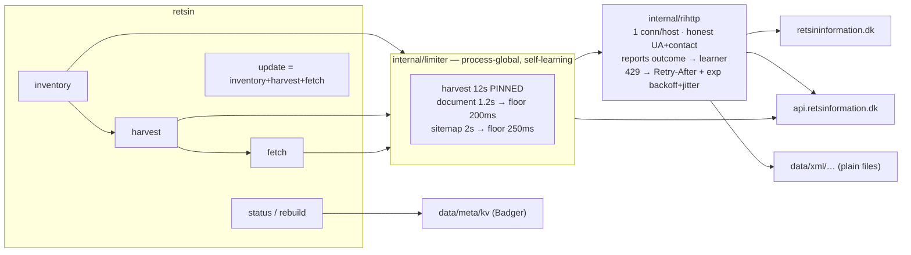

# retsin — Danish legislation mirror

Mirrors [retsininformation.dk](https://www.retsinformation.dk) into a local archive of
canonical ELI XML, and keeps itself current through Civilstyrelsens official change
feed. Written for a full bootstrap of ~200k documents plus years of daily updates,
without getting rate-limited or blocked.

## Status

Bootstrap has **not** been run yet. The pipeline is verified end-to-end against
production (inventory, harvest feed, document fetch, resume, state rebuild), but the
full ~200k-document collection is deliberately left for a human to start — see
[Running it](#running-it).

## What the site actually offers

Three distinct channels, measured rather than assumed:

| Channel | Gives | Limit |
|---|---|---|
| **ELI sitemap** `/eli/sitemap.xml` | Full catalogue: **203,152** ELI URIs (+`lastmod`) across 21 pages of 10k | ~22 requests for the *entire* catalogue |
| **ELI XML** `/eli/{path}/xml` | Canonical XSD-validated document text + metadata (~110 KB avg) | uncached (`cf-cache-status: DYNAMIC`) — every hit is origin work |
| **Harvest API** `api.retsinformation.dk/v1/Documents` | Rolling **10-day** change feed | **published: max 1 call / 10 s** → HTTP 429 |

### Rate limits (published)

The harvesting service documents its own limit in its OpenAPI description
(`https://api.retsinformation.dk/swagger/v1/swagger.json`):

> *"Servicen er kaldt for ofte. Den må kun kaldes en gang pr. 10 sekunder."*

It also states the intended usage is **one call per day**, and that the `date`
argument must fall within the last 10 days. Confirmed empirically: ~8 rapid requests
returned a real `429 Too Many Requests`.

The general terms at <https://www.retsinformation.dk/api> grant free, non-exclusive
use of the open data, but require that use *"ikke belaster Civilstyrelsens
datagrænseflade på en uhensigtsmæssig eller uforholdsmæssig måde"* — must not burden
the interface disproportionately. Cloudflare fronts the site, so a block would be
IP-wide. **There is no published limit for document requests**, which is exactly why
this tool imposes its own throttle there.

### Two facts that shaped the design

- `GET /eli/{any-ELI-path}/xml` serves canonical XML for **every** ELI kind
  (`retsinfo`, `lta`, `ft`, `fob`, `mt`, `accn`). No resolution request is needed to
  find an accession first, so the crawl is exactly **1 request per resource**.
- `eli/retsinfo/2026/10019/xml` and `eli/accn/W20261001925/xml` return
  **byte-identical** documents, so accessions are the natural deduplication key.

### XML vs the website's JSON

The site itself uses `POST /api/document/eli/{path}` (body `{}`), returning
`documentHtml` plus metadata. Compared on the same document:

- **XML carries 82k chars of text; JSON's rendered text is only 61k.** The XML is the
  full document, not a metadata stub — `Ministry`, `Status`, `Rank`, `JournalNumber`,
  `Resume`, `Ref_Accn`, `Concerns` and ~25 other fields are all in it.
- JSON uniquely adds only the site's internal DB `id`, `isHistorical`,
  `pdfLink.isPdfAvailable`, and rarely-populated `editorialNotes`.

**Decision: store XML only.** It is canonical, XSD-validated and a superset. It halves
the requests (≈2.8 days vs ≈5.6), and HTML can be generated locally from it with zero
extra requests.

## Architecture



### Storage: Badger for state, filesystem for the archive

**Badger holds mutable bookkeeping. Legal document bytes live as ordinary files.**

The XML files *are* the product — they must stay greppable, diffable, rsync-able and
readable without this program. So `data/meta/kv` is a *derived* index: if it corrupts,
`retsin rebuild` reconstructs it from the XML on disk at **zero HTTP cost**. Verified:
deleting the store and running `rebuild` recovered every stored document, and the next
`fetch` issued no requests for them.

Considered and rejected: SQLite (`modernc.org` drags ~40 MB of generated `libc` and the
payload still wouldn't belong in a DB) and a TSV-plus-append-log design, which Badger's
transactions replace outright.

Key layout — all values are tab-separated text, so the store stays readable with
`strings`:

```
i|<eli_url>   lastmod  kind  state  attempts  accession  sha256  bytes  error
a|<accession> eli_url  sha256  bytes  changed_at
h|<date>|<accn>|<reason>  doc_id  type  href  seen_at
H|<YYYY-MM-DD>            "1"    fully-harvested day checkpoint
```

### Data layout

```
<data-dir>/
  xml/<kind>/<year>/<id>.xml   canonical documents — the archive
  xml/accn/<rank>/<year>/<accn>.xml
  meta/kv/                     Badger state (derived, rebuildable)
```

Example: `xml/fob/1980/100.xml`, `xml/retsinfo/2026/10019.xml`.

## Pacing: one hard rule, everything else learned

There are exactly two kinds of limit here, and the tool treats them differently.

**Pinned — proven obligations.** The harvesting service publishes a 1 call / 10 s
limit and returns a real `429` when exceeded, with no `Retry-After` header to be
polite about. That interval is a contract, not an observation, so it is **fixed** and
`config.Validate()` refuses to start if `--harvest-interval` is below 10 s. Pass
`--pinned-intervals` to pin any other bucket the same way.

**Adaptive — everything unpublished.** There is no published limit for document or
sitemap requests, so guessing one is the wrong move: too fast risks an IP-wide
Cloudflare block, too slow wastes the bootstrap. Instead the learner measures the site
and finds its own ceiling — a TCP-AIMD style controller:

| Event | Action |
|---|---|
| `--adaptive-window` consecutive successes | shorten the interval by `/--adaptive-step-down` (1.5×) |
| any `429`/`5xx`/transport failure | **double** the interval immediately, then cool down |
| settled interval | clamped to `[--document-floor, --document-max-interval]` |

It starts conservative (1.2 s) and only tightens on evidence, so it is fast when the
origin is healthy and backs off the instant it isn't. Learning restarts each run —
deliberate, because the site's capacity changes and a persisted fast interval would
begin the next run already presumptuous.

Measured against production: starting at 900 ms with a 250 ms floor, the learner
tightened **900 → 600 → 400 → 267 → 250 ms** across 25 documents, with zero throttles.

## Anti-blocking measures

1. **Process-global token buckets.** Every request in the process passes one gate per
   bucket, so no phase or caller can bypass pacing, and the pinned 10 s harvest floor
   is enforced at startup by `config.Validate()`.
2. **Throttle-aware backoff.** Any 429/503/504 honours `Retry-After`, then backs off
   exponentially 10 s → 15 min **with jitter**, and pushes the bucket forward so the
   *next* request is delayed too. Jitter prevents retry synchronisation. The learner
   doubles the interval on the same signal, so backoff survives past the single
   request that triggered it.
3. **Conservative transport.** 1–2 connections per host, HTTP/2, no worker pool. Extra
   concurrency would only raise block risk without finishing sooner, since pacing is
   the bottleneck.
4. **Honest User-Agent** carrying a contact address, so the operator can email rather
   than ban.
5. **Idempotent, resumable phases.** A resource already on disk is closed with **no
   request at all**, so a multi-day crawl can be interrupted freely and a second pass
   costs nothing.
6. **Bounded retries.** Resources failing `--max-attempts` times stop being retried
   instead of consuming the polite budget forever; non-retryable 4xx never retries.
7. **Run-end warning** if the server throttled us at all during the run.

## Configuration

Flags only — no config file and no environment overrides, so `ps` and a cron line show
exactly what a run will do. Run `retsin --help` for the full list. The important ones:

```
--data-dir DIR            archive + state location (default ./data)
--harvest-interval 12s    pinned; cannot go below the published 10s
--document-interval 1.2s  starting document pace
--document-floor 200ms    fastest the learner may settle at
--document-max-interval 5m slowest backoff may reach after throttling
--sitemap-interval 2s     starting pace for sitemap pages
--adaptive-window 20      consecutive successes before a step down
--adaptive-step-down 1.5  divisor per step
--adaptive-cooldown 10m   hold after being throttled before probing faster
--pinned-intervals        freeze buckets instead of learning
--user-agent STRING       keep a contact address in it
--site / --harvest-api    origins
--request-timeout 1m      per-request timeout
--log-level info          debug, info, warn, error
--progress auto           live bar: auto (terminals only), always, or never
```

### Progress bar

`fetch` paints one line that stays put:

```
fetch @250ms  88% |██████████████████████████    | (22/25, 3 docs/s) [6s:0s]
```

The label carries the interval the learner is enforcing *right now*, so the bar
doubles as the pacing readout; the count, docs/sec and ETA come from the bar
library. Three properties were non-negotiable:

- **It never corrupts the log.** The bar and the structured log share stderr, and
  a bar frame ends without a newline — so a log record would otherwise be
  appended to the tail of a frame. `internal/progress.Gate` serializes both
  writers and erases the frame before each record.
- **It disappears by itself.** Off a terminal, the library's invisible mode
  short-circuits before any formatting, so cron runs and redirected output contain
  no escape sequences and pay nothing.
- **A stall is visible.** The crawl reports every resource, including failures, so
  a bar that stops moving means the crawl stopped, not that the bar broke.

The bar is `github.com/schollz/progressbar/v3` (from awesome-go's list); this
repository only adds the gate and guards around the library's rough edges.

Subcommands: `inventory`, `harvest`, `fetch`, `update`, `status`, `rebuild`.

## Running it

```bash
go build -o retsin ./cmd/retsin

# 1. Full catalogue — ~22 requests, ~50 seconds, ~203k resources
./retsin --data-dir /storage/retsinformation inventory

# 2. Official change feed — 10 days × 12s ≈ 2 minutes
./retsin --data-dir /storage/retsinformation harvest

# 3. Documents — 1 request per document
./retsin --data-dir /storage/retsinformation fetch

# Daily thereafter (cron):
./retsin --data-dir /storage/retsinformation update
```

Flags go before or after the subcommand, either form works.

`update` = inventory + harvest + fetch and is safe to run on any schedule: unchanged
documents are never re-requested.

**Estimated bootstrap:** 203,152 resources ≈ **2.8 days** at the 1.2 s default, less if
the learner finds headroom — at the 200 ms floor it is under 12 hours. About 22 GB raw.
Daily updates afterwards are ~1 harvest call plus a few hundred documents.

To explore faster, lower `--document-interval` or `--document-floor` — but note those
requests are served uncached straight from the origin, and the terms ask users not to
burden the interface. The defaults are deliberately conservative; the learner tightens
them only if the site proves it can take it. `fetch --limit N` caps a test run and
`--batch N` sizes the pending window.

## Recovery

If `meta/kv` is lost or suspect, in this exact order:

```bash
./retsin --data-dir /storage/retsinformation rebuild     # relink on-disk XML → zero requests
./retsin --data-dir /storage/retsinformation inventory   # re-discover the catalogue (~22 req)
./retsin --data-dir /storage/retsinformation fetch       # resume; already-held docs are skipped
```

`rebuild` alone recovers only what is on disk; the catalogue comes back from the cheap
`inventory` pass.

## Tests

```bash
go test ./...
```

Covering: pacing guarantees, **the adaptive learner** (step-down after a clean window,
doubling on throttle, floor/ceiling clamps, pinned buckets ignoring all feedback),
live learner integration against a throttling fake server, flag parsing on either side
of the subcommand, 429/`Retry-After` backoff, gzip handling, non-retryable errors, UA
identity, context cancellation, ELI path↔archive-path mapping (including
path-traversal rejection), Badger round-trips and pending/limit semantics, harvest
checkpointing, XML parsing against **three genuine fixture schemas**, the log/bar
writer gate (a record must erase the frame, and never add a clear of its own),
bar modes including silent-off-a-terminal, and end-to-end `Fetch` progress
reporting: one report per resource, correct totals, and a resume pass that
reports while issuing zero requests.

### Bugs the tests caught

- **Manual `Accept-Encoding: gzip`** disabled Go's auto-decompression, so the sitemap
  arrived as 241 raw gzip bytes and failed XML decoding with a misleading syntax error.
- **Badger `Reverse` + `Prefix`** iterated empty, which would have silently broken
  harvest resumption. Replaced with a forward scan.
- **`xml:"Meta>AccessionNumber"` inside a struct already bound to `Meta`** made the
  decoder look for `Dokument/Meta/Meta/AccessionNumber`. Go reports this by leaving the
  field *empty with no error*, so every document looked like it had no accession.
- **Flags after the subcommand were silently ignored** — `fetch -limit 3` ran uncapped.
  Now parsed per-subcommand, and misplaced global flags error out.
- **A progress bar that rendered nothing at all.** The bar library latches its
  `finished` state the first time it renders while its max is still 0 — which is
  how `fetch` starts, since the pending count arrives with the first report. Setting
  the label triggers a render, so the very first label update killed the bar for the
  rest of the run, with no error and no output. `progress.Bar` now refuses to paint
  anything until a real total is known. `OptionClearOnFinish` was the second trap:
  it suppresses the completed frame, so a crawl that reaches its last document shows
  nothing.

## Notes and limitations

- `internal/config.Validate()` enforces the 10 s harvest floor and a 200 ms document
  floor; you cannot accidentally configure an aggressive crawl.
- The harvest feed only covers a rolling 10 days. An outage longer than that can only
  be repaired via `inventory`, which the tool warns about explicitly.
- `inventory` reports ingested rows including any cross-page duplicates; unique
  resources are ~201,600 (Badger is keyed by ELI URL, so duplicates collapse).
- Only the XML pass is implemented. `docapi.FetchJSON` exists as a working client for
  the site's JSON representation, but there is no sidecar crawl; XML is a superset for
  practical purposes.
- **Environment quirk:** this machine's `go` env file and module sumdb path are
  read-only, so adding dependencies needs `GOSUMDB=off`. All deps are already vendored
  into `go.sum`.

## Legal

Laws and regulations are not subject to copyright (Danish Copyright Act § 9). Use is
governed by [Civilstyrelsens terms](https://www.retsinformation.dk/api): free and
unrestricted, including commercial use, provided you do not imply official endorsement
and do not burden the service disproportionately. This tool identifies itself with a
contact address and self-throttles on those grounds.
