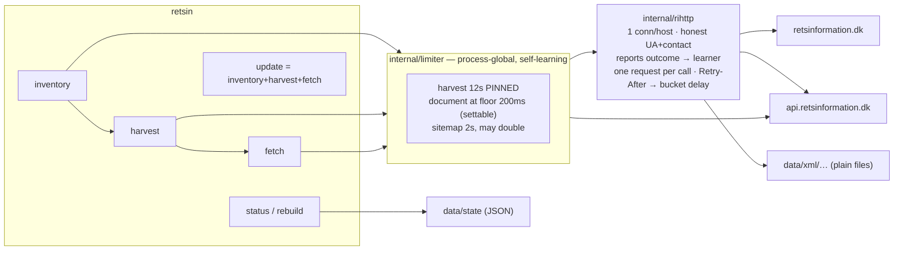

# retsin — Danish legislation mirror

Mirrors [retsinformation.dk](https://www.retsinformation.dk) into a local archive of
canonical ELI XML, and keeps itself current through Civilstyrelsens official change
feed. Written for a full bootstrap of ~200k documents plus years of daily updates,
without getting rate-limited or blocked.

Two programs, which can run on different machines:

- **`retsin-update`** collects: it walks the sitemap, follows the change feed, downloads the
  XML and the site's HTML bodies, and compiles the archive into one **artifact** file
  (`retsin-update artifact build`). It is the only program that talks to the site or reads
  the publisher's XML.
- **`retsin`** serves the artifact: an MCP endpoint, reading pages, full-text search and laws
  as of a date (`retsin serve`, `retsin mcp`). The artifact is everything it reads — no XML,
  no state store, no network — and it cuts its own search index from it. A test
  (`TestTheServerLinksNoCollectionOrXML`) fails if the binary ever links the collecting or
  XML-reading packages again.

## Status

The mirror is running. **191,429 documents** of canonical ELI XML — 14 GB under `data/xml`, split
`fob` 2,865 · `ft` 41,464 · `lta` 63,275 · `ltb` 45 · `ltc` 4,777 · `mt` 6,407 · `retsinfo` 72,596 —
last pulled 2026-09-18 with 14 issues past the retry ceiling, a full-text index of 4,493,745 terms
over those same documents, and a compiled artifact holding all 191,429 of them. Bootstrap was run by
a human, as [Running it](#running-it) describes; the numbers above are what that left behind.

## What the site actually offers

Three distinct channels, measured rather than assumed:

| Channel | Gives | Limit |
|---|---|---|
| **ELI sitemap** `/eli/sitemap.xml` | Full catalogue: **203,152** ELI URIs (+`lastmod`) across 21 pages of 10k | ~22 requests for the *entire* catalogue |
| **ELI XML** `/eli/{path}/xml` | Canonical XSD-validated document text + metadata (~110 KB avg) | uncached (`cf-cache-status: DYNAMIC`) — every hit is origin work |
| **Harvest API** `api.retsinformation.dk/v1/Documents` | Rolling **10-day** change feed | **published: max 1 call / 10 s** → HTTP 429 |

### Rate limits (published)

The harvesting service documents its own limit in its OpenAPI description
(`https://api.retsinformation.dk/swagger/v1/swagger.json`):

> *"Servicen er kaldt for ofte. Den må kun kaldes en gang pr. 10 sekunder."*

It also states the intended usage is **one call per day**, and that the `date`
argument must fall within the last 10 days. Confirmed empirically: ~8 rapid requests
returned a real `429 Too Many Requests`.

The general terms at <https://www.retsinformation.dk/api> grant free, non-exclusive
use of the open data, but require that use *"ikke belaster Civilstyrelsens
datagrænseflade på en uhensigtsmæssig eller uforholdsmæssig måde"* — must not burden
the interface disproportionately. Cloudflare fronts the site, so a block would be
IP-wide. **There is no published limit for document requests**, which is exactly why
this tool imposes its own throttle there.

### Two facts that shaped the design

- `GET /eli/{any-ELI-path}/xml` serves canonical XML for **every** ELI kind
  (`retsinfo`, `lta`, `ft`, `fob`, `mt`, `accn`). No resolution request is needed to
  find an accession first, so the crawl is exactly **1 request per resource**.
- `eli/retsinfo/2026/10019/xml` and `eli/accn/W20261001925/xml` return
  **byte-identical** documents, so accessions are the natural deduplication key.

### XML vs the website's JSON

The site itself uses `POST /api/document/eli/{path}` (body `{}`), returning
`documentHtml` plus metadata. Compared on the same document:

- **XML carries 82k chars of text; JSON's rendered text is only 61k.** The XML is the
  full document, not a metadata stub — `Ministry`, `Status`, `Rank`, `JournalNumber`,
  `Resume`, `Ref_Accn`, `Concerns` and ~25 other fields are all in it.
- JSON uniquely adds only the site's internal DB `id`, `isHistorical`,
  `pdfLink.isPdfAvailable`, and rarely-populated `editorialNotes`.

**Decision: store XML only.** It is canonical, XSD-validated and a superset. It halves
the requests (≈2.8 days vs ≈5.6), and HTML can be generated locally from it with zero
extra requests.

**One exception, measured later and worth knowing before it surprises anyone:** the XML
is a superset only where Retsinformation *has* structured XML. For older documents the
canonical endpoint serves the record and nothing else — `eli/lta/1995/498/xml` (LBK nr 498
af 21/06/1995, the consolidating act behind the 2005 one) is 2,177 bytes of `<Meta>` with
no `<DokumentIndhold>` at all, and the file in the mirror is **byte-identical** to it: the
crawl dropped nothing, there was nothing to fetch. The same document through the site's
own document API returns `documentHtml` with 88,801 chars of markup and **70,075 chars of
text**, headed `<div class="bjelke">Den fulde tekst</div>` — legacy HTML (`<DIV CLASS=PARA
ID="INDHOLD">`) carrying the whole act. So there are two representations, and they are not
ordered the same way as the earlier comparison suggested:

| | modern document | historic consolidation |
|---|---|---|
| canonical ELI XML | 82k chars, superset | metadata only, **0 chars of text** |
| site's `documentHtml` | 61k chars, lossier | 70k chars, sometimes the **only** text |

How far that reaches in the archive: **29,061 of 61,100 `lta`+`ltb` documents (47.6 %)
have no `<DokumentIndhold>`** — essentially all law before ~1995 (96 % of 1975–1999, 28 %
of 2000–2024, none since 2025), and **3,304 of them are still `Status=Valid`**, only 4 of
those from 2010 onward, which turn out to be Finanslove (published as tables, so genuinely
without structured text). The class is mixed in size, not just in age: four sampled
body-less `Valid` documents gave 3,062 chars of real text (lov om fremmede statsskibe,
1950), 840 (a 1950-51 normeringslov, being tables), 343 (a short bekendtgørelse) and 0
further. The large ones are exactly the historic consolidations of major acts — the
documents a version history wants.

**Consequence:** any pre-1995 full-text feature has to be fed from the site's document
endpoint, which means a second parser and one request per document — a decision, not an
oversight. It also explains why a third party parsing *that* HTML has text where the
mirror has a record, while the mirror has the canonical bytes where their parse truncates.
The decision was eventually taken and measured; see *Backfilling the body-less documents*
below.

### Backfilling the body-less documents

Whether the missing bodies are worth a second parser was answered with a 51-document pilot
rather than argued: 25 body-less documents (one per decade from the 1850s, weighted towards
`Status=Valid`) and 26 documents that *do* have an XML body, so the two representations could
be compared against each other on the same text. All 51 payloads are kept in
`data/pilot-bodies/` (gitignored, 7.9 MB).

Fetching costs nothing that the crawler does not already pay. `POST {site}/api/document/eli/{path}`
is the site's **own** endpoint — `internal/docapi` already implements it as `FetchJSON` on
`limiter.BucketDocument`, with tests, and has never had a caller. The pilot ran 51 requests
1.2 s apart (the crawler's floor is 200 ms, so five times slower than production): **0 errors,
0 throttles, 7.9 MB**. This is not the third-party API, so it does not touch that budget.

**The bodies are there, and they are prose.** Every one of the 25 body-less documents returned
text; 18 of 25 gave 2,000 chars or more, up to 70,073 (skattekontrolloven, 1995) and 27,989
(1915). The two smallest were 341 and 429 chars — short bekendtgørelser that were always short.
None came back empty, so the fetch doubles as the census that classifies the rest.

**`documentHtml` is the same tree, in three markup generations.** The class vocabulary maps
onto the XML element names nearly one for one — `Paragraf`/`ParagrafNr`, `Stk2`/`StkNr`,
`Liste1`/`Liste1Nr`, `Kapitel`/`KapitelOverskrift2`, `ParagrafGruppeOverskrift`, `Fodnote`/
`FodnoteNr`, `Bilagstekst`, `TabelTekst`, `IndholdsfortegnelseId` — and for most documents the
elements carry **the same identifier as the XML**: `<p class="Paragraf" id="id3880dfc9-…">` is
`<Paragraf id="id3880dfc9-18ae-…">`, and a footnote's `<Nota id="Par9_Stk1_Not1">` reappears as
`<a class="FodnoteNr" name="Par9_Stk1_Not1">`. Across the paired documents 9,259 element ids
and 266 of 277 `Nota` ids were found in the HTML, so a pair can be aligned element-by-element
rather than by guessing from layout.

| generation | seen in | shape |
|---|---|---|
| legacy SGML | mostly pre-1960, 13 of 25 stubs | `<DIV CLASS=PARA ID="INDHOLD">`, `<P CLASS=PARAB> <B>§ 1. </B>`, `NAME=""P1""`, `&aelig;`, unquoted attributes, unclosed tags — **not XML-parseable** |
| mid-century lowercase | ~1960–2000 | `<p class="Titel2">`, `<p class="Paragraf" id="id…">`, `<span>` |
| modern | 2000 onward | `<table class="Indholdsfortegnelse">` TOC, anchored `<p class="Paragraf">` + `<span class="StkNr">`, `<table>` for bilag |

Only 16 of the 51 payloads parse as XML at all, so the reader needs a tolerant tokenizer;
`golang.org/x/net/html` is the standard one and is not currently a dependency.

**Fidelity, measured on the paired documents: 99.48 % with no content loss found.** Comparing
every `Paragraf`/`Stk`/`Indledning`/`Afsnit`/`Kapitel`/`Bilag` element of the 24 paired documents
against the HTML — 13,266 elements, footnote (`Nota`) text excluded because it is relocated:

| result | elements | |
|---|---|---|
| text verbatim in the HTML | 13,197 | 99.48 % |
| in a document whose bilag are `<table>` | 46 | 0.35 % |
| inline footnote marker inserted mid-sentence | 14 | 0.11 % |
| heading and body are separate `<p>`, probe spanned both | 5 | 0.04 % |
| whitespace at a link boundary only | 4 | 0.03 % |

Every residual is a *representation* difference, not missing content — including the one that
looked like a second instance of their-side text loss (§ 73 of `lta/2007/1561`): the XML and the
HTML hold the identical sentence and the identical footnote 2. That is the argument for building
the HTML reader **against these paired documents** and not trusting it on stubs until it reproduces
XML-derived structure it already knows.

**Scale, if it is run for real:** 29,061 documents ≈ 4.5 GB at the pilot's mean of 155 KB per
payload, and about ten hours at 1.2 s spacing — or a few hours at the crawler's own 200 ms floor.
The 3,304 `Status=Valid` documents alone are ≈ 0.5 GB and well under an hour.

**Where the payloads go: beside the XML.** `data/xml/lta/1995/498.xml` and
`data/xml/lta/1995/498.json` — one directory per document, so a stub and its body are found
together and the existing path mapping is shared. `lexdania.Scan` only reads `*.xml`, so the
sidecars are invisible to the index and cannot disturb it. The cost is stated honestly: this
relaxes the promise in `internal/archive`'s package doc that the archive holds one immutable
file per document, and it means `data/xml` is no longer a byte-exact mirror of the site's XML
endpoint but a directory of two representations per document. `.json` payloads are the raw
upstream response — keeping only `documentHtml` would throw away `isHistorical`,
`alternativeMedia` and the rest of the triage fields that classify a stub as prose, table or
PDF-only.

**Implemented as `fetch --bodies-scan` / `fetch --bodies`** (`internal/crawl/bodies.go`).
Detection is a file walk, not a state-store query — the archive is the product and the store is
derived, so after a store loss the queue has to be re-derivable from disk. A file is work when
it has no `<DokumentIndhold` element and no sidecar; `accn/` paths are skipped as aliases, since
an accession file is a second route to a document the archive also stores under its own ELI
path, and queueing both spends two requests on one payload.

Queueing happens in a **separate keyspace** (`b|`, beside `i|` for inventory), because one
document is legitimately two facts at once: *we hold the canonical XML* and *we still need its
text*. Folding the body into the inventory row would make the 29k body-less laws look like
unfetched XML, and the crawler would spend origin requests re-downloading metadata it already
has. The state store then answers the question the filesystem cannot — which documents have
**nothing to fetch** — with two terminal states: `gone` for a 404/410, and `empty` for a payload
that came back with no prose (`Finanslove` and their tillægsbevillinger are published as
tables). Both keep their payload on disk, so a future reader can tell *unrecoverable* from
*never fetched*. A payload that fails to parse is `failed`, not `gone`: a Cloudflare challenge
arrives with HTTP 200, and retiring a document because of one would be a silent data-loss bug
spanning years.

The measured scope, so a run can be chosen rather than guessed at: **29,061** `lta`/`ltb`
documents have no XML body, and about **101k** across every kind; at the pilot's mean of 155 KB
that is 4.5 GB for the laws, and ~15 GB for everything *if that mean holds outside `lta`* — the
pilot only measured the laws, and `ft` documents run forty times smaller than `fob` ones, so
treat the second number as an upper bound until a `--bodies-scan` says otherwise. A first run
therefore looks like:

```
retsin-update fetch --bodies-scan                          # the census, zero requests
retsin-update fetch --bodies --kind lta --limit 50         # fifty sidecars, one series
retsin-update fetch --bodies --kind lta,ltb                # the laws, ~10 h at 1.2 s spacing
retsin-update fetch --bodies --state empty                 # re-test the table documents
```

`retsin-update status` reports the two representations apart — `canonical xml: N, SIZE` and
`body payloads: N, SIZE` — plus the body queue's state counts, so "how much of the corpus has
text now" is one command. A sidecar already on disk closes its row **without a request**, which
is the resume path after an interrupted run, and a second pass over a completed one issues zero.

### Which tokenizer reads the sidecars, measured before choosing

`documentHtml` arrives in three generations, so the reader's first decision is what tokenizes
it. The choice was measured on the 51 pilot payloads rather than argued, comparing
`golang.org/x/net/html`'s tokenizer against a 90-line hand-rolled one:

| measured | result |
|---|---|
| elements recovered | **both exactly match the raw count: 59,987 of 59,987** on all 51 payloads |
| `class` / `id` / `name` attributes | identical counts on every payload, including unquoted SGML values (`CLASS=PARA`) |
| entities | stdlib `html.UnescapeString` decodes the corpus's entire vocabulary (`&aelig;` 201, `&oslash;` 196, `&aring;` 131, `&nbsp;` 128, numeric ones) — x/net adds nothing here |
| `NAME=""P1""` (SGML doubled quotes) | **x/net loses it**: an empty `name` plus a junk attribute. 224 of 818 anchor `name=` attributes in the sample, in 11 of 51 payloads, all legacy |
| dependency | 1 module, 2 packages (`html`, `html/atom`) |

So x/net is chosen **with a pre-pass** that rewrites `attr=""V""` to `attr="V"`: on the sample
neither tokenizer has an advantage, and the doubled-quote loss is fixable in one regex either
way, but the sample is 51 of 29,061 payloads and the failure mode being guarded against is
silent text loss across the corpus. x/net's *tree* parser is deliberately not used — it fixes
up structure, inserting implied tags and relocating mis-nested ones, which is exactly what a
fidelity mapping must not inherit.

Implied closure is hand-rolled regardless of the tokenizer, and its scope is small enough to
enumerate: the only elements that ever lack an end tag are `hr`, `br`, `col`, `img` (void in
HTML anyway) plus `span`, `tr`, `center` and `p` — 419 `hr` and 26 `span` across the modern
payloads, 44 `hr`, 21 `BR`, 21 `span`, 15 `tr` across the legacy ones, and **zero** across the
mid-century ones. That is a stack with a void-element set, not a tree builder.

### Mapping payload classes onto element names, with evidence per row

Only **6.3 %** of measured payload elements carry a class that *is* one of the 81 canonical
element names, so the vocabulary cannot be mapped by name arithmetic — it has to be a table, and
every row needs a reason. Three independent joins provide one:

| join | matched | what it decided |
|---|---|---|
| element `id` shared with the paired XML | 156 | `StkNr` is `Stk`'s printed number, not a `Stk` — it carries the *parent's* id; `Liste1` is `Indentatio formaInd="Nummer"` |
| squeezed text equal to a canonical element's text | 55 (49 unambiguous) | a cell's prose `TabelTekst` is `Exitus`, while the unclassed `<td>` is the `Td` — canonical shape is `Td > Exitus > Linea > Char` |
| class equal to a canonical name | 6.3 % of elements | enough to place the rest, nowhere near enough to derive them |

`internal/lexdania/htmlclass.go` is that table, and the test asserts coverage of the corpus:
**59,987 of 59,987 elements classified**, against measurements checked in as
`testdata/html-vocabulary.txt` (128 `(tag, class)` tokens) and `testdata/canonical-elements.txt`
(81 names from a 2,045-file random sample). The payloads themselves are gitignored, so the
measurement is the thing that stays reviewable, and the mapping may emit no name that sample has
never seen. Measured split: marker 14,498 · section 12,468 · text 12,266 · table-cell 7,057 ·
inline 5,220 · container 2,832 · table-row 2,536 · skip 957 · note 821 · break 486 · centreret 584
· signature 226.

A class attribute can hold more than one name — the corpus has `span class="Bold Italic
Subscript"` — and when the whole value is not in the table, the first component the table
recognises wins: the editor wrote semantics before typography, and the single-class case never
reaches that path.

Two questions the classifier refuses, because one element cannot answer them:

- **A centred provision line.** `IkraftCentreretParagraf` is appendix material and `Exitus` is
  prose, and the difference is whether the entry-into-force rule (`hr.ikraftstreg`) came first.
  The row returns `roleCentreret` and the builder decides.
- **A class the table has never seen.** It returns `roleUnknown`, which the builder records on the
  document *and* places by tag, so the text still lands. Folding an unknown class into the tag's
  default is how a new provision type silently stops being a provision.

The legacy generation cannot be validated by alignment at all — **no paired document has a legacy
SGML payload** — so those rows rest on text conservation instead.

### Reading a payload back into the canonical tree

`internal/lexdania/htmlbody.go` turns a `documentHtml` payload into a `*Node` tree in the shape
`Parse` produces from XML, so `Sections()`, `Match()` and consolidation handle both without a
branch anywhere downstream. What the payloads force, measured:

- **The mixed-content invariant is built, not repaired.** Every element opens with one empty run;
  text accumulates into it; appending a child closes that run and opens the next. A repair would
  be a guess about where text belonged.
- **Implied closure follows the corpus, not a tree builder.** Only `span` and `tr` are ever left
  unclosed (47 and 15), so only those get rules — and they close the *outermost* match, because
  prose wrappers live inside cells and a new row must reach past them. A new cell must stop at the
  cell, or a table's columns become rows.
- **Footnotes move.** The payload keeps note text at the bottom and the marker where the note is
  referenced; the canonical tree puts the text at the reference, so anchors are created at the
  marker and filled when the text arrives. The same class means both things — in the legacy
  generation the note's *own* marker is an `<a class="FodnoteNr">`, the same tag a reference
  uses — so only being inside the note paragraph tells them apart. A note that finds no anchor
  stays where it was and is counted: unreported, that is a note attached to the wrong sentence.
- **Drops are accounted for.** The text of every skipped subtree is recorded, so conservation
  compares "everything in the payload" with "tree + recorded drops" and needs no copy of the drop
  rules of its own.

Conservation runs over six real payloads checked into `testdata/`, as two separate claims: the
**character counts** must match — whitespace cannot be compared, since adjacent elements are glued
in a payload (`1942Under`) and separated in the tree, and neither is wrong — and the **order** must
match exactly wherever nothing relocated. `Node.Text()` is not document order: it joins one node's
own runs, which puts a paragraph's trailing text ahead of its marker's, so the comparison walks
`Runs`/`Elems` interleaved. All 23 guards in the builder and the pre-pass are proved by patching
each out.

### Measured against the paired corpus

Every one of the 51 pilot payloads also has canonical XML on disk, so each provision in the XML can
be looked for in the tree the builder produced. The falsifiable question is not "is the text in the
payload" — that was measured before any reader existed — but whether the **builder** loses text the
payload had:

| provisions compared | found verbatim | **lost by the builder** | absent from the payload itself |
|---|---|---|---|
| 13,283 | 13,281 (**99.98 %**) | **0** | 2 |

The pilot's estimate with no reader at all was 99.48 %, with the residuals split between documents
whose tables were not parsed and headings whose body is a sibling element. Both categories are now
**zero** — the reader rebuilds tables and closes cells the way HTML does — so the remaining two
provisions are text the payload never carried. The measurement is pinned in
`testdata/paired-fidelity.txt` because the payloads it came from are gitignored, and a run that
finds no paired documents **fails** rather than passing with zeros.

**The legacy generation has no XML to align against**, so those payloads are checked the other way:
reading them must lose nothing and invent nothing. Across all 51 payloads the character counts
match, the interleave invariant holds, no element carries a class outside the table, and — for the
39 documents with no footnote material, which is the only material that moves — the text appears in
the same order. Measured: 11 SGML-generation payloads, 266 footnotes relocated to their reference,
13 left unanchored, 682 elements closed implicitly, and 1,564 stray end tags tolerated.

### Splitting the payload's flat paragraphs into stykker

A payload cannot nest, so it writes a paragraph and its sub-stykker as siblings:

```html
<p class="Paragraf" id="P2"><span class="ParagrafNr" id="Par2_Stk1">§ 2.</span> Herved …</p>
<p class="Stk2"><span class="StkNr" id="Par2_Stk2">Stk. 2.</span> De i Anledning …</p>
```

Canonical nests them — `Paragraf > Explicatus + Stk > Exitus` — and `Sections()` only
recognises a stykke as a **direct child** of a paragraph, and only looks for numbered
items inside one. A flat tree has no "stk. 3" to resolve and never even searches for
"nr. 2", so an amendment citing "§ 2, stk. 3" reports the provision as missing from a
law that contains it. `internal/lexdania/htmlnest.go` rebuilds the nesting under three
rules the corpus decided:

- **Only what canonical nests may be absorbed:** `Stk` (10,432 under paragraph
  elements), `Exitus` (22 directly under a paragraph, 11,161 under a stykke),
  `Indentatio` (3,457 under a stykke) and `AendringsNummer` (261 under a paragraph).
  Anything else ends the paragraph — a stolen heading is invisible in the text, while
  an unresolved address is not.
- **Absorption is segmented, not incremental.** Attaching each element to "the
  paragraph, or else its last stykke" reorders text whenever two elements land at
  different depths: on `lta_1896_71`, § 30's list items went into the stykke while the
  sentence introducing them went into the paragraph, so the items read ahead of their
  own introduction. Each segment head now takes a contiguous slice of the payload's
  order, which makes reordering structurally impossible.
- **The printed number is not necessarily the first child.** The site emits an empty
  anchor (`<span id="P1"/>`) before `<span class="ParagrafNr">`. Requiring the marker
  at index 0 built no first stykke for those paragraphs, left their prose
  unaddressable, and made the payload's own `p.Stk2` the first stykke — shifting every
  later `stk. N` by one. Empty children are skipped; a child holding text is not.

An unnumbered `p.Paragraf` stays flat on purpose: that is the preamble sentence naming
the law an amending act changes, and `amendments.go` reads a paragraph's *own* prose
for it. Payload stykke ids are adopted rather than synthesised — `Par2_Stk1` sits on
the number span and is the same identifier the paired XML carries — and are moved off
the span, so one id names one node.

Measured over the 51 paired documents by comparing the addresses `Sections()` produces
on each side (`testdata/paired-section-parity.txt`):

| canonical addresses matched | …with identical text | absent from the tree | same address, other text |
|---|---|---|---|
| 11,349 → **15,269** | 7,039 → **15,082** (84.7 % of 17,797) | 6,448 → **2,528** | 4,310 → **187** |

25 of the 51 canonical files are metadata-only stubs, where the tree **adds** structure
the XML does not carry — which is the point of the backfill, and why the comparison is a
multiset of addresses rather than a tree diff. Three residual classes remain, each a
separate decision: chapter numbers the payload prints only in the heading beside the
chapter (`kapitel` 217 missing *and* 222 extra — the same chapters read differently by
two trees, not lost), centred provisions whose payload class is filed under prose rather
than under `AendringCentreretParagraf` (most of the remaining `stk`/`paragraf`
residual), and quoted stykker inside an amendment's proposed text, which canonical
excludes deliberately. All 21 guards on the pass are proved by patching each out, and
the harness re-runs an unmutated control around every mutation — an earlier version of
it reported six holes that did not exist, because a mutation that fails to compile is
not evidence and a mutation that changes nothing proves nothing.

### The provision number the payload prints as prose

The register's own XML keeps a provision's number in `<Explicatus>` beside its text. The
payload prints it as the first words *of* the text, usually inside a bold run
(`<P class="Paragraftekst"><B>§&nbsp;6.</B> Arbejdsformidlingen …`), and in the legacy SGML
shape as an element of its own with no period (`<P CLASS=PARAB> <B>§ 5 </B> </P>`). Both
`Sections()` and the model read the marker, so where the text comes only from the payload the
reader had nothing to read from: over a 2,016-document sample, **236 of the 750 documents that
have provisions gave no provision a number at all** — 4,587 of 11,402 provisions, 37 % of the
`lta` shelf. Those documents have text you can search and no way to be told where in them you
are standing.

`attachBody` therefore promotes the printed number into the marker. It is a move and not a copy:
the document's text stays what the page shows, and the number is now also where the XML body
keeps it. Two rules keep the promotion from inventing names. The period decides number from
citation — `§ 6.` names this provision, while `§ 3 finder ikke anvendelse` and
`§ 3, stk. 2 finder …` name another one, so a missing period with prose following refuses. And
the marker has to *be* the number: a numbered item inside a provision is emitted as an
`Explicatus` too and its text quotes other provisions, which initially gave one bekendtgørelse
the number 1 for its § 3, § 4, § 6 and § 11.

Measured after, by `TestHTMLBodyProvisionsGetNumbers` and the serving baseline
(`internal/mcpserver/testdata/serve-baseline-20260918.txt`): **171 of 7,805 provisions in
payload-bodied documents still have no number (2.2 %)**, and the residual is the quoted shape —
"§ 12, stk. 2, affattes således: …" inside a consolidated act, "§ 10, stk. 1, nr. 4: Mundtlig
eksamen …" inside a ministry note — text that cites a provision rather than being one, which
stays unnumbered on purpose. On the same 1,000-document serving sample, citations that lookup
can open went from 369 of 1,000 documents (section units, measured before the 179 refusals were
added) to **1,000 of 1,000** under the model units, still with none unopenable, and the gate
carries no allowance: a cited address that cannot be re-opened is a defect from its first
occurrence. The count rose because a document the section list could not cite at all — the
paragraphs of a folketingssag, an annex letter printed only in a heading — now yields a citation
the model can name, or none rather than one invented.

### Older versions of a law are already in the archive

The obvious question for an archive is whether *superseded* versions of a still-current
act can be downloaded — e.g. what § 12 said in 2019. **They cannot be fetched, and they
do not need to be.** Measured, not assumed:

- The site's own ELI spec (`/static/eli-parameters-documentation.json`) documents **11**
  URL parameters — `pubMedia`, `year`, `month`, `day`, `number`, `language`, `format`,
  `accn`, `classification`, `docType`, `metadataFileFormat`. **None of them is a version,
  date or time-travel parameter.**
- `eli-technical-documentation.json` describes the canonical URI as showing *"the original
  version"* of the document, and the corpus agrees: of 6,000 sampled `lta` documents,
  **zero** cite an amendment dated after their own publication year. ELI XML is the text
  *as promulgated in the gazette*, not a consolidated current text.
- Non-resources confirmed by probing: `/eli/lta/2025/331/version/1/xml` and
  `?version=2` both return the JavaScript SPA shell (HTTP 200 + HTML, so a crawler must
  treat HTML as "no such representation", never as success).

So a law's history is not hidden behind snapshots — **every version is its own
document**: the base act plus each amending act, each with its own ELI URI, all already
listed by the sitemap. What has to be *computed* is the consolidated text at a given
date, by applying amendments in date order. The link to follow is `<Concerns id="…">`,
non-empty in 54.5 % of `lta`, 81.3 % of `retsinfo` and 76.3 % of `mt` documents (2,500
sampled each; `ltc` is 0.1 %, being EU notices). The site does not merge either, and the
endpoint once cited here as evidence that it does — `/api/extremesearch/getcasehistorystatus`
— is only a parliamentary bill-state enum (417 bytes: `Afvist`, `Beretning afgivet`, …),
measured 2026-09-19. What the site publishes and what it displays is in the next section.

One trap worth naming: the two digits at the end of an accession number are **not**
version counters. 1,086 accession bases in the archive hold more than one accession, but
1,082 of those are `ft`/`fob` parliamentary items, which simply number each sitting
(`…00`, `…01`, `…02`). Only 4 law bases have more than one, so "group by base, highest
suffix wins" is not a valid way to find current law — `Status`, `EndDate` and
`DateOfHistoricMark` are.

**Consequence for the design:** nothing here justifies a version-discovery crawl. The
archive stays "one immutable file per published document", and consolidation becomes a
job for the derived layer. The qualifier found later is that *being* a document is not the
same as carrying text: for law before ~1995 the canonical XML is often metadata only, so
the version is present and its words are not (see the exception above).

### Cross-checked against a third-party consolidation API

`retsinformation-api.dk` (run by syv.ai) serves the same archive as JSON, including a
computed version history per document. It is a useful second opinion — the same upstream
XML, consolidated by someone else — and it is rate-limited hard: **35 requests per hour,
100 per day**. The comparison cost 23 calls; every payload is cached under `data/jsonapi/`
and each call is written to `data/jsonapi/.ledger.json` *before* it is made, so a re-run
costs nothing and a crashed run cannot double-spend.

What the endpoints mean, measured rather than assumed (skattekontrolloven, 2005/1126, was
the control case):

- `GET /v1/lovgivning/{year}/{number}/versions` is **per document**. Every row carries the
  accession of the law itself, never of the amender; versions are told apart by
  `version_number` plus `effective_date`.
- `/versions/1` is the document **exactly as promulgated**, not the oldest *state*. Proved
  with a control pair on LBK 942 af 02/10/2009: text introduced by an amendment effective
  *before* it was issued is in their v1 and in our XML, and text from an amendment
  effective *after* is in neither. `effective_date` on v1 is not a start date either — for
  that 2009 act it says 2023-01-06, thirteen years after promulgation, which is when the
  service began tracking the document, not when the text began to apply.
- `/versions/at/{date}` resolves **across documents**: asking for 2005/1126 as of
  2005-12-01 returns `A19950049829` (LBK nr 498 af 21/06/1995) — a different document in
  the statute's lineage with its own `version_number`, so that number means nothing
  outside one document.
- `paragraph_count` and `chapter_count` come back null on `/versions/{n}`. The usable
  structure is `structure.chapters[].paragraph_groups[].paragraphs[]`, each with its
  printed `number` ("§ 3 a.") and `stk[]` of `{number, text}` — which is the shape
  `lexdania` produces, so the two can be aligned provision by provision.

Aligned on printed numbers across the ten hardest laws (see the ranking below):

| | result |
|---|---|
| provision numbers | ours is a subset on all ten — no number we produce is missing from theirs. Their extra entries (3–43 per law) are entry-into-force provisions numbered against *other* laws (§ 375, § 438), which `Appendix` deliberately excludes, plus one heading rendered as a paragraph ("§§ 13-17") and numbers repeated six times (§ 9 in lov om aktiv socialpolitik) |
| subsection text | **8,412 of 8,570 aligned subsections identical (98.2 %)**; 598 where *their* text stops dead at a footnote or list marker while ours continues ("1) …"); **zero** where ours stops early, on any of the ten |
| the rest | 152 of the remaining 158 are characters we keep and they drop; 6 are real, and 1 of those is substantive |

The substantive one: § 274 of lov om finansiel virksomhed. Their v1 says the supervisory
authority may have experts follow a firm for "op til **12** måneder"; our text says **6**.
The archived XML contains `op til 6` once and `op til 12` not at all, so our parse is
faithful to the promulgated document and their v1 is not — which is the value of the
exercise even when the answer is "not our bug".

The 152 character differences turned out to be a bug **here**, not a cosmetic gap — see
the zero-width entry under "Bugs the tests caught".

One limit this exposed about our own side: **48 % of `lta`+`ltb` files have no body at
all** (28,547 of 59,776 carry `<Meta>` and no `<DokumentIndhold>`). The case that surfaced
it is `A19950049829`: our file is 2,177 bytes of metadata, and the service's copy of the
same `UniqueDocumentId` 62968 is 68 paragraphs of text. For superseded consolidations of
that era the archive is an index, not a text, so an oldest-revision comparison only means
something where we hold the body.

### The publisher publishes no merged text, at any layer

This is the section that decides whether the amendment engine is a feature nobody
asks for or the only way to have the feature at all. Measured against the live site
on 2026-09-19, not inferred from the archive.

**The documented machine surface is one endpoint.** `api.retsinformation.dk` answers
`GET /v1/Documents` and its own swagger (`/swagger/v1/swagger.json`, titled
*Retsinformation høsteservice API*). One path: a rolling **10-day** feed of
individually promulgated documents, to be called *"én gang i døgnet"* between 03:00
and 23:45 at one call per 10 seconds, with a changelog running back to 3/4-2022.
No version parameter, no chain, no consolidation. The guide list the swagger points
at (`/offentlig/vejledninger`) holds exactly **6** documents — four for the Eunomia /
Lex Dania editor and client, one generic decisions webservice, one harvest-API guide —
and none of them mentions consolidation. `/v1/lovgivning/…` on that host is 404, so
the version endpoints cached under `data/jsonapi/` are the third party's, not the
ministry's.

**Their own document API serves the promulgated text.** `POST /api/document/eli/lta/2019/1399`
returns 722,149 bytes whose `documentHtml` is 679,330 bytes; stripped of tags that is
292,875 characters against the 293,385 our canonical XML yields — the difference is
their contents table versus our `<Meta>` block, not wording. § 21 is **identical between
the two for the first 3,000 characters**, and it is the 2019 wording:

| | § 21 opening |
|---|---|
| their `documentHtml`, our base XML | `§ 21. For de enkelte brandklasser gælder følgende: 1) For byggeri i brandklasse 2 …` |
| our `as_of` 2026-09-19 | `§ 21. For byggearbejder i de enkelte brandklasser gælder følgende: 1) For byggearbejder …` |

The amended wording exists in no single published document; it exists because it was
merged. Their page is therefore older than the answer we give.

**Nothing in their output marks a change.** Attribute census over the same 679,330
bytes: `class` 4,577, `id` 3,061, `style` 696, `valign` 493, `href` 46 — and **no
`data-*` attribute, and zero accession numbers anywhere in the body**. There is no
machine-readable change location to consume. `/api/document/metadata/B20190139905`
shows why there cannot be: 14 fields, all publication facts, no version and no
effective date, and *"Dato for førstegangsindlæggelse"* equals *"Dato for seneste
indlæggelse"* (both 17/12/2019) — the record is never rewritten in place. What the
site does instead is `/api/document/211473/references/0`: groups headed *"Senere
ændringer til forskriften"*, *"Lovgivning forskriften vedrører"*, *"Ændrer i/ophæver"*
— a link list, the same chain we read from `<Concerns>`, rendered as an accordion
whose rows say *"Se detaljer for paragraf"*. Annotate and link; do not merge.

**HTTP 200 is still not success.** Six more guessed paths — `/api/document/211473/versions`,
`/consolidated`, `/amendments`, `/current`, `/structure`, `/api/versions/211473` — all
answered 200 with 3,567–3,584 bytes of SPA shell.

**Consequence: a refusal is the cost of a feature the source does not offer.** A
refusal (`UnresolvedEdit`, `internal/lexdoc/consolidate.go:157`) is a change the
engine could not place, so it left the text alone and reported the failure instead of
guessing. BR18 as of 2026-09-19: 17 of 17 amending acts found and effective, **515
edits attempted, 406 applied, 109 refused**, nothing missing from the mirror, nothing
belonging to another law, no bills. Nineteen distinct reasons collapse into three
classes in the printed warning — 62× the address is not in the current text, 40× the
wording is not recognised by the pattern set, 3× the address is absent with no
positional anchor. Refusing is what makes the count visible at all: `Trustworthy()`
is false, and the answer says the text may still show the older wording. It also
means the refusal count is a clock rather than a grade — the Danish answer to
amendment drift is a fresh consolidating re-issue whose preamble absorbs the changes,
and BR18 has run nearly seven years without one.

**The third-party service is not an escape hatch** on arithmetic alone: 191,429
documents at 35 requests/hour is about 5,469 hours, roughly **228 days** of
non-stop polling, and about 5.2 years at the 100/day ceiling. The cached pilot under
`data/jsonapi/` cost 23 calls, and no code in `internal/` references `/versions`.

**The class of failure worth the effort is not the refusal, it is the phantom.** At
2020-03-05 — the effective date of `B20200018205`, which says *"Efter § 298 indsættes
i kapitel 11 … § 298 a"* and *"Efter § 327 indsættes før overskriften før § 328:
§ 327 a"* — the tree engine reports **applied 5, refused 1** while the provision total
stays **579, exactly as promulgated**, where two whole-provision inserts should make it
581. Both inserts are listed as applied, both landed nowhere: `§ 298 a` and `§ 327 a`
resolve at no date in the chain, § 327's text is the same 455 characters at 2020-03-05,
2021-06-01, 2022-12-01 and 2026-09-19, and § 298 at 2020-03-05 and 2021-06-01 is the
promulgated paragraph with no `bygningsautomatik` in it. The current text looks correct
only because the 2022 acts rewrote § 298 wholesale and § 298 a was repealed on
2022-12-06; between 2020-03-05 and 2022-12-06 we serve a law that is missing a provision
which was in force. A refusal discloses itself; an edit reported applied with no effect
does not, which is the same trap `NoOpEdits` was added for.

### Reading the archive: `internal/lexdania`

The archive is only useful if the XML can be loaded without loss, so
`internal/lexdania` parses canonical ELI XML into a **generic tree that keeps every
element, attribute and text run**, then projects the parts that have names onto typed
structs. Nothing is silently dropped, which is what makes the rest of the numbers
below trustworthy.

```go
a, _ := lexdania.Scan(ctx, "data/xml")            // accession -> file index over the archive
d, path, ok := a.Open("A20190021330")             // one document, fully parsed
vs, _ := a.Versions("A20190021330")               // every known version, by effective date
v, _ := a.LawAsOf("A20190021330", date)           // the law as it read on that date
v.Section("§ 12, stk. 2").Display()               // one provision, formatting collapsed
v.Trustworthy()                                   // false if anything could not be applied
```

Decisions worth knowing:

- **A generic tree, not a struct per element.** A struct-per-element design drops
  every element it has not been told about, silently, and the format has 131 distinct
  element names. `Node` keeps `Name, Space, Attrs, Runs, Elems` under one invariant —
  `len(Runs) == len(Elems)+1` — so text and children stay in document order and edits
  can splice text back into the tree without reformatting it.
- **Two identifier schemes, both 12 characters.** `<AccessionNumber>` is a gazette
  accession (`A18521100030`, type code possibly alphanumeric: `G198050837R1`) for
  laws, orders, circulars and rulings — or a parliamentary bill id
  (`201013L00173`, `200423LA0079`) for every `ft/` document. Length alone cannot tell
  them apart.
- **Bills are not law.** `ft/` holds Lovforslag and Betænkning documents whose
  amendment markup is indistinguishable from an enacted act's. `IsBill()` gates the
  consolidator: a proposal that never passed is never applied.
- **Unmapped is visible.** `Meta` types every element name observed in the corpus;
  anything new lands in `Meta.Rest` and raises a warning rather than vanishing. That
  is how two unmapped fields and three identifier shapes were found.
- **Derived text never mutates the base.** `LawAsOf` clones, and a corpus test proves
  it over real documents.

Measured against the live archive (crawl running concurrently, so counts rise between
runs). The sampled corpus tests: **400** documents parsed with **0** failures and **0**
unmapped `Meta` children; **364** numbered changes across **25** amending acts with
**96 %** carrying a recognised address and **98 %** classified into an edit kind;
consolidating **5** modern laws applied **46** changes, with **258** changes correctly
identified as belonging to other laws.

An opt-in scan then reads **every** document instead of a sample —
`RETSIN_FULL_SCAN=1`, **132,000-odd** documents and 6 GB in about half a minute on 12
workers — and reports histograms rather than assertions, because the interesting cases
are the rare ones:

| measured over the whole archive | |
| --- | --- |
| parse failures | **0**; HTML payloads and half-written files counted separately, never fatal |
| tree-invariant violations | **0** |
| numbered changes | **172,840**, of which **1.2 %** stay unclassified |
| by kind | replace-text 50,758 · insert-provision 37,968 · replace-provision 23,006 · insert-text 16,676 · delete-provision 11,865 · delete-text 7,479 · unknown 1,953 · renumber 1,741 · replace-everywhere 908 · non-operative 817 |
| entry-into-force appendices | **11,681** documents, **18,623** provisions numbered like the law's own |

What is still *not* applied is reported as the changes the engine refuses, and the tally
consults `Edit.Kind` and `Address` rather than re-reading the prose — so a shape leaves
the table when the library gains a mechanism for it, instead of sitting there because
this file's regexes were not updated. **10,894 of 172,840 changes (6.30 %) in 4,246
documents** are not applied as written:

| not applied, and why | changes |
| --- | --- |
| insertion at a numbered sentence ("indsættes som 2. pkt.") | 6,735 |
| footnote attached to the document title | 1,528 |
| annex transferred out of the amending act ("affattes som bilag 1") | 1,077 |
| change wording we do not classify | 1,031 |
| address we cannot parse | 518 |
| change names no provision | 4 |

Every one of those is refused with a reason in `View.Unresolved` rather than applied
somewhere plausible. Shapes that were in that table and are not any more, with the counts
the same scan now reports for them: renumbering instructions ("Stk. 2 bliver herefter
stk. 3.", **1,741**) are *checked* rather than executed, because numbering here is
positional and the insertion in the same block has usually already done it — where it has
not, the refusal quotes the subsection count it found; preamble rewrites (**1,271**) and
document-title rewrites (**374**) are addressable units now; global replaces ("Overalt i
loven ændres »X« til: »Y«", **908**) rewrite every
occurrence and stop at word boundaries; territorial and validity notes (**817**) are
recorded as asking for no change to the text; and `Afsnit` numbered in roman numerals
(**540** changes, **4,286** elements) have numbers at all — the elements carry no
`localId`, so until now the section list held an entry with an empty number that no
reference could match.

One measurement is deliberately *not* quoted: applying a real chain to the archived copy
of its law. A consolidated act already contains the amendments that were in force when
it was published, and an amending act cites the accession that existed when it was
written — often not the one archived — so an "applied" rate over real chains measures the
archive's bookkeeping rather than the parser. Address resolution is measured change by
change against the published text of the law named instead, with its exclusions printed
alongside: insertion addresses name a position that does not exist yet, and multi-law
acts address laws other than the one sampled.

Known limits, measured rather than estimated: an instruction that places text *inside* a
sentence ("indsættes som 2. pkt.") is refused rather than appended to the end of the
subsection, and annex rewrites ("Bilag 1 affattes som bilag 1 til denne bekendtgørelse")
are reported unresolved rather than attempted; both are placements the model cannot
represent, and 6,735 plus 1,077 changes sit in `View.Unresolved` because of them. In the
handful of multi-law amendment acts where each block names a different law, target
attribution is still coarse — 49 of the 62 unresolved changes in the sample
came from one such act. Anything not applied is listed in `View.Unresolved` with a
reason, and `Trustworthy()` reports `false`.

## Architecture



### Storage: JSON files for state, plain files for the archive

**The state is a few hundred thousand small rows, held in memory and kept as JSON. Legal
document bytes live as ordinary files.**

The XML files *are* the product — they must stay greppable, diffable, rsync-able and
readable without this program. So `data/state` is a *derived* index: if it is lost,
`retsin-update rebuild` reconstructs it from the XML on disk at **zero HTTP cost**. Verified:
deleting the store and running `rebuild` recovered every stored document, and the next
`fetch` issued no requests for them.

It is three files (`internal/store`):

```
state/current.json    what the mirror holds and knows: every catalogue row (lastmod, kind,
                      state, accession, sha256, bytes), every stored body, the feed changes,
                      the harvested days and the pull record
state/queue.json      retry bookkeeping: attempts and the last error of every row not yet
                      answered with content
state/journal.jsonl   every change since those two were written, one per line
```

`current.json` is what a fresh machine needs to carry on collecting, so it is the part that
travels; `queue.json` is local, and losing it only resets retry counters — a row still owed
says so in `current.json` (`pending`, `failed` or `stale`), and rows past the retry ceiling
are simply tried again. The journal is why a killed run loses nothing: every write appends a
line before the method returns, opening replays it (a torn last line is ignored), and closing
folds it into the two files, each written to a temporary name and renamed. Both files are
written one row per line in key order, so two states diff line by line and a
content-chunked store keeps the rows that did not change. A lock file keeps it to one
collecting process at a time.

Measured on the live mirror (201,800 catalogue rows, 101,727 body rows, 191,612 accessions,
1,397 feed changes): `current.json` is 103 MB and 21.7 MB under `zstd -19`; `queue.json` is
0.9 MB (15 KB compressed); loading both takes about a second. It replaced a Badger store, and
the move was checked row by row — every field of every row identical, except the attempt
counts of fetched rows, which nothing read — with the pull record's fingerprint unchanged
(`eb14429b`).

Considered and rejected: SQLite (`modernc.org` drags ~40 MB of generated `libc` and the
payload still wouldn't belong in a DB) and Badger, which this replaced: a database is a lot
of machinery for state that fits in memory, and its files cannot be published, diffed or
read by anything else.

### Data layout

```
<data-dir>/
  xml/<kind>/<year>/<id>.xml   canonical documents — the archive
  xml/accn/<rank>/<year>/<accn>.xml
  state/                       collection state as JSON (derived, rebuildable)
```

Example: `xml/fob/1980/100.xml`, `xml/retsinfo/2026/10019.xml`.

## Pacing: one hard rule, everything else learned

There are exactly two kinds of limit here, and the tool treats them differently.

**Constants — proven obligations.** The harvesting service publishes a 1 call / 10 s
limit and returns a real `429` when exceeded, with no `Retry-After` header to be
polite about. That interval is a contract, not an observation, so it is a **constant**
(`config.HarvestInterval`, 12 s for clock-skew margin) with no flag: there is no
configuration in which going faster is acceptable. The sitemap pace (2 s) is a
constant too, because it was measured rather than guessed.

**Adaptive — everything unpublished.** There is no published limit for document
requests, so guessing one is the wrong move: too fast risks an IP-wide Cloudflare
block, too slow wastes the bootstrap. Instead the learner measures the site and holds
the fastest pace it can sustain — a TCP-AIMD style controller that starts optimistic
and lets the service correct it:

| Event | Action |
|---|---|
| startup | begin at `--document-floor` and stay there while the service is happy |
| 20 consecutive successes (`limiter.Window`) after a throttle | shorten the interval by ÷1.5 (`limiter.StepDown`), working back towards the floor |
| any `429`/`5xx` | **double** the interval immediately, then hold it for a 10 min cooldown before stepping back down |
| any transport failure | neither faster nor slower, but it breaks the success streak, so recovery only happens on clean windows |
| interval | clamped to `[--document-floor, limiter.MaxInterval]` |

Only the **floor** is a flag. It is both the interval a run starts at and the fastest
one the learner returns to, which is why everything else above is a constant: every
measured run behaved the same way, with nothing to react to. More knobs would only be
more ways to misconfigure a crawl.

The floor is a default, not a limit. 200 ms is what a considerate pace looks like for
requests served uncached straight from the origin, but lowering it is honoured rather
than refused — the feedback then comes from the service itself as a 429, which the
learner answers by doubling the interval on its own.

Learning restarts each run — deliberate, because the site's capacity changes and a
persisted fast interval would begin the next run already presumptuous.

**Jitter** is the second pacing flag, and it is about signature rather than speed. A crawl
that runs for days at exactly 200 ms is a recognisable machine, so each wait gets a random
share of the current interval added on top — 10 % by default, up to 20 ms extra at the
floor. It never shortens a wait, so `--document-floor` stays a hard minimum. `--jitter 0`
gives exact spacing, which is the setting to choose when the question is whether a service
limit is what you are hitting: then nothing else is varying, and a 429 means what it says.
The interval and the jitter in force are printed on the progress bar (`fetch @200ms ±10%`)
and in the startup line, so a flag that did not take effect is visible rather than implied.

Measured against production: the 200 ms floor sustained **4.1 documents/s over the
first ~2,100 documents with zero throttles**, which is why the learner starts there
instead of crawling down to it. If that guess is ever wrong, the cost is one doubled
interval — the learner finds the safe pace by being corrected, not by probing upward.

## Anti-blocking measures

1. **Process-global token buckets.** Every request in the process passes one gate per
   bucket, so no phase or caller can bypass pacing, and the 10 s harvest obligation is
   a constant with no flag that can lower it.
2. **A throttle changes the schedule, not the retry count.** Any 429/503/5xx reports
   the outcome to the learner, which doubles the interval and holds it through a
   cooldown. If the server sends `Retry-After`, that wait is applied to the **bucket**
   rather than sleeping the request open, so the next request is delayed too and a
   cancellation still takes effect immediately. The client issues exactly one request
   per call: the crawl re-selects a failed resource on a later sweep instead of the
   HTTP layer hammering a service that has just said no.
3. **Conservative transport.** 1–2 connections per host, HTTP/2, no worker pool. Extra
   concurrency would only raise block risk without finishing sooner, since pacing is
   the bottleneck.
4. **Honest User-Agent** carrying a contact address, so the operator can email rather
   than ban.
5. **Idempotent, resumable phases.** A resource already on disk is closed with **no
   request at all**, so a multi-day crawl can be interrupted freely and a second pass
   costs nothing.
6. **Bounded re-attempts.** A resource is re-tried on a later sweep at most five times
   before it stops consuming the polite budget; permanent 4xx (404/410) is recorded as
   gone and never asked for again.
7. **Run-end warning** if the server throttled us at all during the run.

## Configuration

Flags only — no config file and no environment overrides, so `ps` and a cron line show
exactly what a run will do. Run `retsin-update --help` (or `retsin --help` for the server) for the full list. The important ones:

```
--data-dir DIR           archive + state location (default ./data)
--document-floor 200ms   the interval to start at and the fastest to return to
                         (a default, not a limit: lower is honoured)
--jitter 10              random extra wait, as a percentage of the current interval
                         (0 = exact spacing)
--user-agent STRING      keep a contact address in it
--site / --harvest-api   origins
--request-timeout 1m     per-request timeout
--log-level info         debug, info, warn, error
--progress auto          live bar: auto (terminals only), always, or never
--limit / --batch N      on fetch: trial size and rows per selection batch
--kind KINDS             on fetch: restrict to ELI series, e.g. retsinfo or lta,ltb
--state STATES           on fetch: restrict to inventory states, e.g. failed or gone
--bodies                 on fetch: work document *bodies* instead of canonical XML
--bodies-scan            on fetch: the body census only, zero requests
--order asc|desc|random  on fetch: which end of the catalogue to visit first
--random-seed N          on fetch: fix the shuffle for --order random (0 = pick and log)
```

`--bodies` is a different unit of work, not another kind: `--kind`, `--state`, `--limit`,
`--batch` and `--order` all apply to it, and its states are the body queue's own
(`pending`, `fetched`, `empty`, `failed`, `gone`). See
[Backfilling the missing bodies](#backfilling-the-missing-bodies).

Everything else about pacing is either a published obligation (12 s harvest), a
measurement (2 s sitemap), or the learner's own shape — all constants, all asserted in
`internal/config/config_test.go`.

### Progress bar

`fetch` paints one line that stays put:

```
fetch @250ms  88% |██████████████████████████    | (22/25, 3 docs/s) [6s:0s]
```

The label carries the interval the learner is enforcing *right now*, so the bar
doubles as the pacing readout; the count, docs/sec and ETA come from the bar
library. Three properties were non-negotiable:

- **It never corrupts the log.** The bar and the structured log share stderr, and
  a bar frame ends without a newline — so a log record would otherwise be
  appended to the tail of a frame. `internal/progress.Gate` serializes both
  writers and erases the frame before each record.
- **It disappears by itself.** Off a terminal, or with `--progress never`, the bar is
  simply not constructed, so cron runs and redirected output contain no escape
  sequences and pay nothing.
- **A stall is visible.** The crawl reports every resource, including failures, so
  a bar that stops moving means the crawl stopped, not that the bar broke.
- **It is built with its total.** The pending count is taken before the bar exists,
  so there is no "unknown total" state to render, no placeholder denominator, and no
  frame that reads as a finished crawl. A run with nothing pending gets no bar.

The bar is `github.com/schollz/progressbar/v3` (from awesome-go's list); this
repository adds the gate and the rule above, and nothing else.

Subcommands: `inventory`, `harvest`, `fetch`, `update`, `status`, `rebuild`.

## Running it

```bash
go build -o retsin ./cmd/retsin

# 1. Full catalogue — ~22 requests, ~50 seconds, ~203k resources
retsin-update --data-dir /storage/retsinformation inventory

# 2. Official change feed — 10 days × 12s ≈ 2 minutes
retsin-update --data-dir /storage/retsinformation harvest

# 3. Documents — 1 request per document
retsin-update --data-dir /storage/retsinformation fetch

# Daily thereafter (cron):
retsin-update --data-dir /storage/retsinformation update
```

Flags go before or after the subcommand, either form works.

`update` is the daily refill: harvest, then download what is new, changed, or
missing — including the JSON body payloads — and record when it pulled and what it
could not get. `--full` adds the sitemap pass, which is the only
pass with full scope; see [the collection contract](#keeping-it-current-the-collection-contract).

**Measured bootstrap:** the learner reaches the 200 ms floor within ~1,000 documents and
held **4.1 requests/s** there with zero throttles, so 201,580 resources is roughly
**14 hours** of unattended crawling. Daily updates afterwards are ~1 harvest call plus a
few hundred documents.

Archive size is **not** settled. Per-document averages differ by series by a factor of
forty — `fob` runs 43.7 KB, `ft` 1.0 KB — and the two largest series (`lta` with 63,284
rows, `retsinfo` with 82,654) were still unfetched when that was measured, so the honest
band is **3–8 GB**. Sample them with `--kind` below instead of trusting an
extrapolation.

To crawl faster, lower `--document-floor`: the tool honours it and leaves the judgement
to the site. Those requests are served uncached straight from the origin, and the terms
ask users not to burden the interface — which is why 200 ms is the default, not why it
would be a wall. The learner only reaches the floor if the site proves it can take it.

### Keeping it current: the collection contract

A mirror that quietly stops being current is worse than one that is openly behind:
the whole point is that readers do not have to check. So the collection cycle keeps
three stamps, and each authorises something different.

| stamp | written by | what it means |
|---|---|---|
| `H\|<date>` | each harvested feed day | the change feed for that day was read to the end |
| `last_sitemap_inventory` | `inventory` | the catalogue was re-read; every row knows its current `lastmod` |
| `last_full_sweep` | every `update` | when it pulled, how much it still owes, and a fingerprint of which documents those were |

**The 10-day rule.** The harvesting service answers for a rolling ten days
(`harvest.MaxWindowDays`), so a mirror whose last recorded pull is older than that
cannot be refilled honestly: the changes in between are listed nowhere any more.
`retsin-update update` therefore **fails** rather than collecting a partial set and leaving
the mirror looking current — it fails *before the first request*, and says to run
`update --full`, which re-reads the sitemap and finds every change by `lastmod` for
about 22 requests. `--force` exists for deliberate repair and is the only other way
past; the gate is a flag, not a warning an operator learns to scroll past. A `--full`
run also tolerates a feed gap, since the sitemap pass on that same run covers the
days the feed has forgotten.

**The pull record is an account, not a certificate.** Every pass writes one, complete
or not: the moment it pulled, how many documents it still owes, how many are past the
retry ceiling, and an eight-digit fingerprint of *which* they were. The alternative —
recording nothing until a pass finishes with both queues drained — discards the true
statement "we pulled today, and these fourteen documents would not come", which is the
statement an operator and a reader actually need. A mirror can only hold what the site
agrees to serve, so completeness is not a fact available here and withholding a
timestamp cannot invent it.

The fingerprint does what the counts cannot. `owed=0 stalled=14` on two consecutive
nights says nothing about whether anything changed; the same digest says it is the same
fourteen documents the site refuses, and a moving digest says something new broke. The
counts and digest travel in the state store row, in `data/sweep.stamp` for readers that
cannot open the locked store, in `retsin-update status`, into the header of the next artifact built
(`compiled.ArtifactHeader.Collection`), and from there into the dataset line of every answer
served from it.

`owed` counts rows still pending *or* failed while under the retry ceiling; past the
ceiling they are `stalled` and are reported apart, since no automatic pass will ever
fetch them and `retsin-update fetch --state pending` is the remedy.

**An inventory pass merges; it does not overwrite.** The sitemap reports every
resource it has ever advertised, and the rows it hands over carry only URL, `lastmod`,
kind, and pending. A blind upsert — which is what this did originally — throws away
every hash, accession and attempt counter, so the nightly crawl would re-close 200k
files locally and re-request the ~10k resources already recorded as `gone`. Only a
moved `lastmod` may touch a row: that is the sitemap's only change signal.

**`stale` is why amended documents are reachable at all.** The fetch loop closes any
row whose file is already on disk without asking the site — that is what makes
re-running an inventory pass affordable. It also means an amended law, once
downloaded, can never be updated: the row gets re-pended, the file is found, the row
is closed, and the mirror keeps serving the superseded text while reporting itself
current. So a moved `lastmod` on a row whose bytes we hold marks it `stale`, the one
state the on-disk shortcut does not apply to. `retsin-update rebuild` deliberately does not
downgrade those rows, because re-deriving state from disk re-derives exactly the
older copy.

**The feed is read back, not just written.** `retsin-update changes` resolves each harvested
accession against the archive and reports how many are queued, how many were collected
with new bytes, and how many are unknown to the mirror. It exists because the feed is a
dead end as a *mechanism*: it names documents by accession and `href`, never by ELI
URL, so it can describe a change to a document this mirror has never seen without being
able to fetch it. That resolution is the missing piece if the feed is ever to drive
downloads rather than annotate them.

Measured on the live mirror, 2026-09-18 (yesterday's full crawl, today's first refill):

| measurement | value |
|---|---|
| feed entries over the full 10-day window (first harvest ever on this mirror) | 2,195 |
| distinct changes after de-duplicating by date + accession + reason | **424** — the feed re-lists a change on the days that follow it, so entry counts must never be read as change counts |
| feed changes that resolved to a document already in the archive | 424 of 424 |
| feed changes naming a document this mirror has never seen | 0 |
| rows the first inventory pass queued, out of 201,616 | 1,438 |
| documents the refill collected | ~1,300 rows worked, **35 genuinely new** files |
| rows left owing after the refill | 1 (a `retsinfo` path the site answers **HTTP 500**), carried in the pull record and fingerprinted; it later joined the 14 rows past the retry ceiling |
| permanently failing rows, reported and not blocking | 14 |
| request rate | 47–52 documents/min, dropping to 400 ms pacing when the site errors |
| `held rows with a September lastmod that were stored before their own lastmod` | **0 of 308** |

**The site cannot be asked cheaply.** `HEAD`/`GET` on an `/xml` ELI path returns no
`ETag`, no `Last-Modified` and no `Cache-Control`, so there is no conditional request to
make: confirming that a `stale` row is still the same document costs the whole
transfer. Revalidation is therefore a budget question, not a protocol trick.

**`lastmod` moves in bulk and means less than it looks.** A second inventory pass half
an hour after the first marked 872 rows stale, and a third took that to 1,188 — Civilstyrelsen
refreshes `lastmod` across many resources at once, and the sitemap also advertises some
resources twice with disagreeing dates (203,188 entries for 201,616 resources). Hence the
strict rule above — only a *later* date is a change — and hence the census: of the 308
held rows whose `lastmod` is in September, **none** had been stored before its own
`lastmod`, so the archive is not demonstrably behind. `TestStaleContentCensus` (gated,
`RETSIN_STALE_CENSUS=1`) re-asks the site whether moved `lastmod`s really mean new bytes,
and its report is checked in at `internal/crawl/testdata/stale-census-20260918.txt`; the
trap set is the number that will matter once the mirror has been running long enough to
fall behind.

**Whether the feed has to drive downloads is still open, and it is a rule rather than a taste.**
The feed names an accession and never an ELI URL, so a change to a document this mirror has never
seen cannot be fetched from the feed alone — only a sitemap pass can find it. The rule the decision
is being made against: **one** such accession means the feed has to drive downloads; zero across
every harvested day is the only evidence that leaves the feed as annotation and reconciliation.
Measured so far, over the eight feed days the store holds (2026-09-09 to 2026-09-18, 424 distinct
changes): 424 resolved to held resources, **0** named an unseen document, 0 were left queued or
behind. The collection cycle harvests the rolling window on every run, so the days keep
accumulating; `retsin-update changes --report` writes each reconciliation to a dated file under
`data/reports/` that is never overwritten, so the decision is read off files rather than off
whatever the last person to run the command remembers.

### Narrowing a run

Pending resources are visited in ELI URL order by default, so a series that sorts late stays
out of reach until everything before it is done — see [Changing the order](#changing-the-order)
for `--order`. `--kind` selects by ELI kind, which is the axis the sitemap itself groups
on:

```
retsin-update fetch --kind retsinfo --limit 50    # sample one series
retsin-update fetch --kind lta,ltb --kind ltc     # several at once: comma-separated or repeated
```

`--limit N` caps the run; `--batch N` sizes the pending window. The bar's total honours
the filter, and a kind with nothing pending warns rather than finishing silently.

### Changing the order

The catalogue is stored in ELI URL order, which is chronological within a kind, so the
default walk meets 1873 before last month's law. `--order` chooses the other end:

```
retsin-update fetch --order desc --limit 20     # the twenty most recent documents
retsin-update fetch --order random --limit 200  # an unbiased sample of the catalogue
```

`desc` walks the same keyspace backwards and pages by cursor exactly like `asc`, so it costs
what a forward crawl costs, and reaches the part of the corpus that is read and amended
most first.

`random` is not a scan direction. The keyspace is stored in URL order, so a shuffled order
has no cursor to resume from: the selection is materialised once as ELI URLs — a few tens of
megabytes for all 201,579 rows — and drained in shuffled order, which is cheaper than
re-scanning the catalogue once per batch to re-derive the same shuffle. The seed is logged at
`debug` level, and `--random-seed` repeats a sample exactly.

`asc` stays the default deliberately: a mirror aiming to finish should finish in order, and a
random default would turn a partial crawl into a shallow skim of everything.

All three compose with `--kind` and `--state`, all three honour `--limit`, and all three
visit each selected row once per invocation. An order that does not exist is an error, not a
silent fallback to another one.

### Retrying failures

`--state` selects by what happened to a row last, which is how failures get a second chance
without re-crawling anything:

```
retsin-update fetch --state failed                 # retry every failure
retsin-update fetch --state gone --kind retsinfo   # re-test 404s in one series
retsin-update fetch --state fetched                # re-check rows that claim to be on disk
```

A default run takes `pending` plus `failed` rows still under the retry limit, so a
permanently dead URL cannot spin forever. **Naming a state lifts that limit**: the ceiling
exists to protect the automatic sweep, and `--state failed` is a deliberate override, so a
row already tried 99 times is fetched again. `gone` covers both ways a representation can be
missing (404, or HTML served where XML was expected) and is worth re-testing after changing
`--site`. `fetched` is the repair path for a row whose file has gone missing — with the file
present it closes without a request, so only the genuinely missing rows cost anything.

States compose with `--kind`, the bar's total follows both filters, and a state name that
does not exist is an error listing the valid ones rather than a silent empty run.

Each invocation visits each selected row **once**: the scan pages forward by ELI URL, so a
row that is still in the selection after being fetched — a 404 re-tried under `--state gone`
is written back as `gone` — is not offered again in the same run. Re-running the command is
what re-tests them, and the forward cursor also means a long crawl no longer re-walks the
whole 200k-row keyspace once per batch.

### Backfilling the missing bodies

Half the law corpus has no text in its canonical XML: `/eli/…/xml` returns metadata only, and
the document's prose exists nowhere in the mirror. The site does have it, in the JSON payload its
own pages are rendered from, so `fetch --bodies` fetches that payload and stores it **beside**
the XML — `data/xml/lta/1995/498.json` next to `498.xml`. See
[Backfilling the body-less documents](#backfilling-the-body-less-documents) for the pilot that
established this works and what the payloads contain.

```
retsin-update fetch --bodies-scan                     # census only: 0 requests
retsin-update fetch --bodies --kind lta --limit 50    # 50 requests, one series
retsin-update fetch --bodies --kind lta,ltb           # the laws, ~10 h at 1.2 s
retsin-update fetch --bodies --state empty            # re-test the table-only documents
```

The scan and the fetch are separate on purpose: `--bodies-scan` prints what the archive holds
(scanned, with an XML body, sidecars already held, queued) and costs nothing, so the scope of a
spend is chosen from a measurement. `--bodies` then walks that queue through the **same**
adaptive document bucket as the XML crawl — same floor, same back-off, same throttle learner —
because the endpoint is the site's own and deserves the same care, not because it has a quota.
It has no quota; the third-party `retsinformation-api.dk` budget is a separate ledger and this
path does not touch it.

Three properties are what make a 10-hour run safe to interrupt:

- a sidecar that already exists closes its row **without a request**, so a run that died
  between the write and the row costs nothing to resume;
- a second pass over a completed queue issues **zero** requests, including over the rows that
  ended `gone` or `empty` — those are conclusions, not failures;
- nothing here can overwrite canonical bytes: writing a sidecar under the `.xml` extension is
  refused by `internal/archive` rather than honoured.

`retsin-update status` then reports `canonical xml` and `body payloads` separately, plus the body
queue per state, which is the census: `fetched` rows have text, `empty` rows are documents the
site has no text for either.

### Retrying body failures

`--state` means the same thing for bodies as for XML, over the body queue's own states:

```
retsin-update fetch --bodies --state failed   # transient faults: timeouts, challenge pages
retsin-update fetch --bodies --state gone     # documents the site answered 404 for
retsin-update fetch --bodies --state empty    # table documents, to check they still have no prose
```

Naming a state lifts the retry ceiling, exactly as in the XML path, and an unknown state name
is an error listing the valid ones. `empty` is worth re-testing only after a parser change —
re-testing it otherwise is 10k requests for a known answer.

### Sampling paired ground truth

The archive now holds 191,394 canonical XML files (9.4 GiB) and 101,727 fetched payloads (3.2 GiB), so
the question has moved from "get the data" to "is the reader right". For that there are two candidate
references, and only one of them can settle anything:

**The reference is the canonical `<DokumentIndhold>` the archive already holds.** Two representations
published by the same publisher from the same source can disagree *usefully*: a disagreement is evidence
about the reader either way. An aggregator's transcription cannot do that — it can only agree with itself,
so measuring against it proves agreement, not correctness. `internal/docapi` therefore stays a comparison
tool, not a yardstick.

That means the population to sample is the ~89,700 documents whose XML **does** carry the text — the exact
opposite of `fetch --bodies`. Sampling is two phases, because phase one costs CPU and phase two costs
politeness:

```
retsin-update sample --strata                      # what each stratum exists to measure
retsin-update sample --plan --quota centreret=250 --quota random=400 --seed 20260917
retsin-update sample --fetch --limit 30            # trial: does the site even serve HTML for these?
retsin-update sample --fetch                       # the rest, resumable
```

`--plan` reads the archive and writes a manifest; nothing is requested until it is reviewed. Strata are
defined by canonical element markers **pinned against `internal/lexdania/testdata/canonical-elements.txt`**
— `TestSampleNeedlesNameRealCanonicalElements` refuses a needle that is not in that vocabulary, because a
stratum named for an element that does not exist fills its quota with documents that lack the shape it
claims to measure, and the resulting measurement looks authoritative.

Three rules in the selection, each because a plausible alternative was wrong:

- **Targeted strata fill before `random`.** The targeted shapes are scarce; a quota that lost a contention
  with the largest bucket would get none. The cost is stated rather than hidden: `random` is random among
  the unchosen, not among the whole corpus.
- **Round-robin across ELI kinds inside a stratum.** A flat shuffle is dominated by whichever kind is
  largest, so a defect confined to one series survives exactly the sample size chosen to find it.
- **A document claimed by two strata is fetched once and labelled twice.** Two rows would count one
  document twice in the frequency ranking the sample exists to produce.

Payloads go to `data/paired-truth/` in the archive's own layout — **never** into `data/xml`, never into the
state store. A sidecar beside a document that already has canonical XML would make the loader's rule ("use
the sidecar when the XML has no body") ambiguous in precisely the files written to test it, and would
inflate the body census with deliberate duplicates.

Run `--fetch --limit 30` before the full manifest: if the site serves little `documentHtml` for documents
that already have XML, the premise needs restating, and that is a 30-request discovery rather than a
2,500-request one.

### Serving the mirror to agents: `retsin mcp`

```bash
retsin mcp                     # Model Context Protocol over stdin/stdout
```

One tool, `lookup`, in the three forms a caller is likely to hold:

```json
{"method":"tools/call","params":{"name":"lookup","arguments":
  {"document":"eli/lta/2019/1399","address":"§ 1"}}}
{"method":"tools/call","params":{"name":"lookup","arguments":
  {"document":"B20190139905","as_of":"2021-05-01","max_chars":8000}}}
```

`document` accepts the ELI path, that path with the site in front of it (with or
without the trailing `/xml`), the path without the `eli/` segment, or an accession, in
either case. `address` is Danish citation form (`§ 267, stk. 3 nr. 2`, `kapitel 5`,
`bilag 2`, `indledningen`); `as_of` consolidates the amendment chain instead of reading
one stored version.

Three properties are deliberate:

- **Read-only, and not by convention.** The command never opens the state store, which
  is locked to the collecting process; serving needs the artifact, so that is all it
  opens — and a process that cannot write is easier to trust in front of a legal corpus.
- **Text comes from the compiled artifact when one exists.** `retsin mcp` reads
  the current artifact (`<data-dir>/artifact.current` names it; `--artifact` pins one file instead,
  `--artifact-cache-mb` sizes its cache) — so a lookup is a
  seek and a decode rather than an XML parse, and the status line says which of the two a client
  is being served from. An artifact holding another document model is refused at startup with the
  side that is stale named, because the file holds the model as JSON and would otherwise decode into
  this server's types with another revision's meaning; one holding this server's model is read
  whichever build wrote it.
- **Every answer is markdown, and names its text.** `- **Text source:** xml|html|none` with
  the payload path for `html`, plus the mirror's document count and index time; the statute
  itself is fenced so nothing in it is re-read as markup. `html` means the sentence was
  recovered by our reader, and the note says what that is worth (84.9 % of paired documents
  matched byte for byte).
- **A tool is advertised only when it can answer.** `search` appears in `tools/list` only
  when an index file was loaded; with none, the server serves `lookup` and says so on
  stderr. A client that discovers mid-conversation that a listed tool cannot answer has
  already trusted the list.
- **`search` returns provisions, not documents.** Each hit carries ELI, accession, section
  address, the document's text source and a passage read back out of the archive — the
  index deliberately stores no legal text. See the next section for how it is built and
  what the measurements decided.

Stdout carries the protocol and nothing else, so logs go to stderr. To exercise it by
hand, keep stdin open — the server exits when the pipe closes, which is correct
behaviour for a client that spawns it and costs a confusing empty run otherwise:

```bash
( printf '%s\n' \
  '{"jsonrpc":"2.0","id":1,"method":"initialize","params":{"protocolVersion":"2025-06-18","capabilities":{},"clientInfo":{"name":"smoke","version":"0"}}}' \
  '{"jsonrpc":"2.0","method":"notifications/initialized"}' \
  '{"jsonrpc":"2.0","id":2,"method":"tools/list","params":{}}' \
  ; sleep 5 ) | ./bin/retsin mcp
```

The protocol is the official Go SDK (`github.com/modelcontextprotocol/go-sdk`). It is
one dependency rather than a hand-rolled JSON-RPC subset because the specification is
still moving and getting it subtly wrong produces a server that "works with my client".
The sandbox cannot reach the module checksum database, so the recorded `go.sum` hashes
were compared against the public `sum.golang.org` lookup for `v1.8.0` and match.

### Reading the mirror in a browser: `retsin serve`

```bash
retsin serve                        # http://127.0.0.1:8787 — pages and MCP on one port
retsin serve --addr 0.0.0.0:8787    # on the network: there is no auth, and reading is all there is
retsin serve --addr 127.0.0.1:9000 --verbose-requests
```

`retsin mcp` serves one agent that spawned it. This command is for the people who read the
same documents: the same serving core, the same rules (the file archive is all it opens, so
a nightly crawl is never locked out of the state store), one port, pages at `/` and the MCP
endpoint at `/mcp`. No JavaScript, no cookies, nothing that remembers a visitor — which also
means a document cannot run anything in the browser that reads it, only say things.

| Path | |
|---|---|
| `/` | one search box, four queries to start from, and when the mirror was last checked |
| `/search?q=` | hits and gaps, in the syntax `retsin search` takes: `AND`, `-word`, `"two words"`, `art:lov`, `year:1987-2000` |
| `/browse` | everything the mirror holds, by kind, year and initial letter, 200 at a time |
| `/dok?ref=` | the text, with a table of contents in front. `ref` is an ELI path or an accession; `&addr=§ 5, stk. 2` shows one provision inside the whole |
| `/status` | counts, index time, which fast paths are off and how to turn them on |
| `/mcp` | the MCP endpoint — an agent and a person get the same text out of the same process |

**Everything naming a document is a link, and the link carries its address.** Three kinds:

- **The frame around it** — what this document changes, what changed it, when each piece took
  effect. Only documents the mirror holds become links; the ones it does not are named with
  the reason ("changed by … — text not held"). A line carrying its reason beats either a dead
  link or a quietly missing one.
- **The provision** — every heading gets an `id` and the table of contents points at those
  ids, so `…#kapitel-3`, `…#bilag-2`, `…#ikraft` are URLs you can send to someone.
- **The sources** — the publisher's own ELI URI, and for a law the earliest version the
  archive holds.

The ids took thought, because the publisher's numbering is not a tree of unique keys. A
document gives its pieces printed numbers, but a change-only bekendtgørelse often numbers
only its paragraphs and has no top-level number at all, and bilag repeat. So one
reading-order walk over the document assigns every id, from the printed number when the
document has one and from its position when it has none — the fallback form is
`kind--u<path>`, whose double dash is unreachable by the slug that turns printed numbers into
ids, so a fallback can never collide with a real number. `internal/lexdoc/html_test.go`
asserts that on a document built to have nothing numbered: two parts and three provisions,
none with a number, and every `id=` appearing exactly once.

Measured with a link-following crawl of the running server over the real mirror (191,429
documents, 4,493,745 index terms, no artifact, so text came from parsing XML):

| | |
|---|---|
| requests, of which 400 document pages | 2,341, **0** non-200 |
| document HTML | median 18 KiB, largest 1,248 KiB, 17 MiB in the sample |
| ids marked | 8,295, on **0** pages where one was repeated |
| contents links on 60 whole documents | 2,075 resolving on the page they were on, **0** missing |
| contents links on 22 narrowed views | 907 resolving on the page they name, **0** missing, **0** ending in a bare `#` |
| pages with a live `<script>` | **0** |
| a document page | 2–29 ms for the small documents in that sample, 53 ms for a 765 KB one; a search 78–1,417 ms; warm file cache |

A page shows a document whole. The character cap that keeps an MCP answer inside an agent's context
had been carried over to pages, where it cut the one thing the page does not render — the mirror's
largest document page, 13,090,321 bytes, printed "Svaret er afkortet" beside a complete document. The
cap belongs to the answer path alone (`TestLookupTruncatesAnAnswerButNotAPage`); the bound on a page
is whatever the publisher published. And the page is the same page whichever path serves it: 138 of
138 pages were identical byte for byte from the artifact and from the XML, apart from the line that
names where the text came from.

The first version of that crawl found two bugs the fixture tests had missed, and both are
gone: 522 contents links pointed at an anchor the page did not hold (a narrowed view shows
one provision but lists the whole document, so its table of contents has to point *forward*
to the page that holds each part), and 2 contents links had an empty anchor because nothing
had assigned those pieces an id at all.

Text on screen is the text the tools answer with. The page is produced by the same single
walk over the document model, in a third mode, and `TestMarkdownShape` still passes
byte-identically — markdown and plain text did not change shape to make room for HTML. MCP
clients get `Text` and never the HTML. That the endpoint on this port is real MCP and not
HTML-shaped homage is proven by a test that drives it with the official SDK client.

The port has no authentication, which is why the default is `127.0.0.1`: whoever can reach
the port can read the corpus.

### Full-text search: `retsin index build`, and what the measurement decided

```bash
retsin serve                            # builds the current artifact's index itself when it needs one
retsin index build                      # the same build by hand, beside the artifact
retsin search "pligt fyringsanlæg" --limit 5
retsin search "ubetinget råderet" --source xml --since 1990
```

**The server keeps its own index; indexes are not distributed.** The index is cut from the
compiled artifact, and only the artifact is published. Every artifact build carries a random
128-bit stamp in its header, and an index records the stamp of the artifact it was cut from plus
the version of the code that cut it (`search.CutVersion`, bumped by hand when unit-cutting
changes). At startup `serve` and `mcp` use the index on disk only if it names the artifact being
served and this build's cut; otherwise — missing, unreadable, an older file format, another
artifact, older cutting code — they rebuild it in the background, save it, and switch search on
when it is ready, about a minute later. Lookups and browsing answer meanwhile, the MCP `search`
tool and the web page say search is on its way, and `make deploy` no longer builds the index.

**Built from the artifact, in about 4 GB.** Whoever holds the artifact can build the index that
goes with it, without the mirror. The artifact build stamps each document with
the shelf, year and number the mirror filed it under, which is what the index needs to cite
and filter without the mirror. Profiled with `--memprofile`/`--cpuprofile` (new flags on every
command; the heap profile is taken at the run's peak heap) on 4 cores, as a GitHub runner has:

| | peak RSS | time |
|---|---|---|
| mirror build, before | 27.0 GB | 4 m 47 s |
| artifact build of the index, streaming | 7.0 GB | 2 m 14 s |
| the same with the default 4 GiB `GOMEMLIMIT` | **4.0 GB** | **1 m 35 s** |
| `retsin-update artifact build` (unchanged) | 2.6 GB | 3 m 27 s |

The old peak had 10 GB live and the rest uncollected garbage. Of the live part, 5.4 GB was
the text of every provision, held until the last one was counted, and 3.3 GB was a map from
unit to count per term. The build now streams — a batch of 1,024 documents is read, cut and
counted, and its text let go — and a term's postings are two appended arrays, sorted once.
Each dictionary shard is freed as it is flattened, the file is written straight to disk
instead of assembled in memory, and the index build sets a 4 GiB soft memory limit unless
`GOMEMLIMIT` is given. The result differs from the mirror-built index only where the
artifact's data is better: 191 titles the mirror's header scan left HTML-escaped ("P&amp;T"),
32 with zero-width characters, the duplicate title units those caused in 86 documents, and
6,833 documents numbered 0 that no longer get an ELI path like `eli/ft/1985/0`. The ranking
judgments score identically. `retsin index build --sample N --out file` indexes a
stratum-balanced sample of the artifact (up to N per kind and decade), for measurements.

The index is derived data: cut from the artifact at zero HTTP cost, written to a temporary
name and renamed so a reader never sees a half-built one. It is a plain file rather than a
database for the reasons the state store is (see *Storage* above).

Measured on the whole mirror: **191,429 documents → 5,343,351 units, 4,493,745 terms,
867,402,982 bytes, 1 m 19.7 s to build, 26.24 GB peak RSS**. The build is parallel, and
each half was measured against its own serial run on the same machine on the same day:
reading, modelling and cutting units went 6 m 37.4 s → 37.1 s, dictionary insertion and
posting serialisation 3 m 51.3 s → 42.6 s, whole build 10 m 28.7 s → 1 m 19.7 s, a 7.9×
speedup, at 26.14 GB → 26.24 GB peak RSS. The parallel build is not a different format:
the two files differ in the header's build-time field and in no other byte, which
`tools/idxcmp` checks by loading both and hashing the decoded tables rather than the
compressed stream. Each stage's serial baseline is the same code run with `GOMAXPROCS=1`,
so there is no second implementation to keep honest.

The corpus run is the headline and the expensive one; the cheap instrument for the next
change is a sample. `retsin index build --sample 300` — 12,797 documents chosen across
every kind — runs the same code path in 30.4 s serial against 5.5 s parallel, and
`GOMAXPROCS=1` versus default in one process is enough to catch a layout or ordering
mistake without a twelve-minute round trip.

The index got *smaller* than the section-unit index it replaced — 938 MB,
5,505,907 units, 4,345,622 terms — because the section list posted a paragraph once as
itself, once inside its section and once inside its chapter, and those copies were most of
what the postings carried. Query latency over the 26 measured queries: p50 0.8 ms, p95
29 ms, the p95 being the widest query in the fixture (a compound-head query whose grep truth
set is 54,816 units in the sample); the brute-force baseline over the same text extrapolates
to ~0.7 s per query, so the index is two to three orders of magnitude faster and ranks —
grep is not hopeless, which is why the index stores no text and adds no dependency. (The
26 GB peak above was the mirror build before streaming; see the table at the top of this
section.)

**The unit is a passage, not the document.** A hit in a 300-page act has to name
"§ 267, stk. 3". Units are cut from the model rather than from the publisher's element
nesting: each section, each of its numbered conditions, the text the register prints
*between* conditions (the section's own number, a lead-in line, a closing sentence),
divisions, annexes, the title, the preamble, the signature block, and the content the model
has no concept for, in runs capped at 2,000 runes. Each word is indexed exactly once. The
section list nested its units inside each other, so a paragraph was posted three times — as
itself, as part of its section, as part of its chapter — while the words it held were
reachable only where that nesting happened to exist.

An address is kept only if the model's own lookup opens it back to the same content:
`Content.Find(ParseAddress(addr))` must return the very provision, condition, division or
annex the unit holds. An amendment act is why that check rather than a naming convention
does the work — an act amending ten laws prints "§ 2" ten times, lookup answers the address
with the first of them, and citing the other nine by it points a reader at the wrong
provision. Those units keep their words and are cited as the document: imprecise rather
than wrong.

Measured against the unitisation this replaced, over the same 9,237-document sample
(`internal/search/testdata/index-measurement-20260918-sections.txt` and
`…-model.txt`, reproduce line in each header) and over 1,597 mirror documents in
`RETSIN_SEARCH_UNITS=1 go test ./internal/search -run TestModelUnitsOverMirrorResolve`:

| | section units | model units |
|---|---|---|
| of a document's served words, share the index can find (sample; over the mirror 0.456 → 0.995) | 45.6 % | **99.6 %** |
| indexed text against the text the server renders | 93.0 MB of 174.9 MB (53 %) | 173.1 MB of 174.9 MB (99 %) |
| citations whose opened text contains the words quoted | 89.6 % (10.4 % fail) | **95.8 %** (4.2 % fail) |
| distinct places a reader can follow, over 1,597 documents | 9,739 | **8,296** — and every one of the 2,069 places the section list reaches that the model does not cite is classified: 1,177 item-level (the index stores no positions), 458 conditions the document prints no number for (cited as their section), 145 entry-into-force provisions (cited under the series' own locator), 289 cited but refused by the text check, which is M012T013 |
| old answers still returned to the same query | — | 236 of 250; the 4 that are not are glued-run tokens (`fremsata199212k00198…`), not words |
| answers only the new index can return | — | 164, counted per query group |
| units, index size (sample) | 111,969, 18.0 MB | 151,502, 33.2 MB |

Two query classes came out *worse* on the recall@10-against-grep metric — aa-spelling 0.85
to 0.70, prefix traps 1.00 to 0.55 — and both are classes whose grep truth set nearly
tripled (10,777 to 31,513 and 4,357 to 12,869 matching units). That metric asks which ten
of thousands of matches two correct orderings put first, so indexing half again as much of
each document changes the argument by construction; the answer-parity row asks the two
systems the reader's question instead, and moves the other way. Both numbers are in the
reports, and neither is averaged into the other. The 4.2 % of citations that do not open their
own words are the glued run boundaries tracked as a separate milestone, and the section index
was worse on the same measurement at 10.4 %.

Four decisions were made by measurement rather than by taste. The first two were taken
against `index-measurement-20260917.txt`; the length penalty was re-measured after the unit
change, in both reports of the pair above, because its rationale mentioned unit granularity:

| candidate | result | decision |
|---|---|---|
| reversed terms (compound heads: *afgift* → *ejendomsafgift*) | +62 % size, recall **fell**: aa-spelling 0.75→0.25, citation 0.50→0.05 | **deleted** — reversed terms share the sorted dictionary and steal prefix-expansion slots; compound-head recall was already 1.000 |
| folded stream (inflectional endings) | recall identical on every group (inflected 1.000 both ways), +31 % size, one term query got *worse* | **off by default** — and structurally redundant: folding only removes suffixes, so the stem is always a prefix of the word, which right-extension already reaches |
| BM25 `b` (length penalty) | re-measured on both unit shapes: on model units b=0.75 gives citation 0.633 / aa 0.600 against b=0's 0.800 / 0.700; on section units 0.676 / 0.750 against 0.933 / 0.850 | **b = 0** — a document with no numbered conditions is one long unit, and that unit is exactly what "lov nr. 1399" needs, so penalising length penalised the right answer. The decision survived the unit change; the number behind it is now measured under both shapes |
| positions in postings | every phrase query's top-10 did contain the words adjacent (3/3) | **not stored** — the only measured need for them did not materialise |

Danish-specific normalisation, all guarded: æ/ø/å are never folded into other letters
(*tanke* and *tænke* are different words, so a diacritic-insensitive index returns the
wrong statute confidently); the pre-1948 spelling of Å as "Aa" *is* folded, at word start
only, so a modern query reaches old text; one-rune tokens are dropped (they are list
markers, not words); digits survive, because "lov nr. 1399" is a citation.

Three honesty properties are pinned by tests rather than asserted in prose:

- **`eli/ft/2020/54` matches five documents, not one.** Folketingssager store every stage
  of a bill (LSF, LSV, BTL, BSF, BRB) under one ELI path, and their texts differ. `lookup`
  refuses such a path and lists the accessions; `search` points its "read it" line at the
  accession whenever the ELI is ambiguous. This was found by the first real query, not by
  reading the spec — an ELI path is a locator for acts, not a primary key.
- **The index says how old it is.** The build timestamp and the scoring parameter travel
  in the file header, and a search result reports what *the index* covers — plus a second
  warning whenever that differs from the mirror's current count, in both directions (an
  index behind the crawl, or built over an entirely different directory).
- **A format mismatch is refused, not tolerated.** Adding fields to the header shifted
  every table by eight bytes; a shifted read of a self-describing table can produce counts
  that look entirely plausible. `Load` now rejects a version it did not write and says to
  rebuild.

#### Ranking, judged against questions with known answers

The measurement above is recall against grep: it shows that matches are found, not that the
right one comes first, and on the real mirror the right one did not. For "forældremyndighed",
"barselsorlov" or "opsigelse af lejemål" the first page held bills, amending acts, Faroese
commencement orders and one accounting standard printed as a single annex — everything that
repeats a law's words except the law. `internal/search/judgments_test.go` now holds 100
everyday questions, each with the document a lawyer would open: 57 tuned the ranking, 43 took
no part and show whether it generalises. Score is mean reciprocal rank (MRR) and hit@10.
Four expected answers were corrected after review, each because the hit the ranking gave was
the right law and the pattern was not: bodeling (ægtefælleskifteloven), køreprøve (the order on
driving tests), huslejenævn (lov om boligforhold since 2022) and førtidspension (the law still
governing pensions granted under the old rules).

| | no filters | love og bekendtgørelser, gældende |
|---|---|---|
| tuning, words only (before) | MRR 0.003, hit@10 2 % | MRR 0.17, hit@10 37 % |
| tuning, now | MRR 0.86, hit@10 93 % | MRR 0.84, hit@10 91 % |
| held-out, words only (before) | MRR 0.003, hit@10 2 % | MRR 0.14, hit@10 35 % |
| held-out, now | MRR 0.69, hit@10 81 % | MRR 0.67, hit@10 77 % |

What ranks now, beyond the words (`internal/search/ranking.go`, `DefaultRanking`):

- **What the document is.** A law or lovbekendtgørelse ×3; a bill ×0.25; an act or order
  whose title says it amends or repeals ×0.5; a Faroese, Greenlandic or entry-into-force
  version ×0.5; guidance and decisions ×0.3; anything the register calls historic ×0.25.
- **How much of it answers.** ×(1 + 0.4·ln n) for n matching provisions: a law that uses a word
  in forty sections is about it.
- **Its title.** Query words in the title, weighted by how rare each is among titles. A query
  that names a document ("bekendtgørelse om jagttegn", "vejledning om forvaltningsloven",
  "færdselsloven") weighs the title ×4 and, when it names a type, lifts the type priors.
- **Length.** BM25 b = 0.2 instead of the index's 0; see the comment on `bm25B`.
- **Longer forms.** A word that exists also reaches its inflections and compounds
  ("ansættelsesbevis" → "ansættelsesbeviser"); before, only a word absent from the dictionary
  was extended.
- **Common words only add.** A word in more than 2 % of all provisions ("af", "og") adds to
  provisions a rarer word found but finds none itself. "opsigelse af lejemål" went from 8.8 s
  to 0.2 s, because "af" alone had been scoring 2.2 million provisions.
- **Citations from the register's numbers.** "lov nr. 1399 af 2019" is answered above the ranked
  provisions by the documents with that number (and year, and type when named), because a
  document's own number is rarely in its text.

Each provision is still its own hit, and the proximity grade still reorders the first 20. Run
`RETSIN_RANK_JUDGE=1 go test ./internal/search -run TestRankingJudgments -v` to score the
ranking (8 s, needs the current artifact's index); add `RETSIN_RANK_SWEEP=1 -run TestRankingSweep` to
re-tune it after changing what ranking can see. What it still misses: compounds the corpus
never spells out ("jagttegnsprøve", "momsfradrag"), and questions whose words belong to a
different law than the one meant ("samvær med barnet" finds barnets lov before
forældreansvarsloven).

Guards: 34 mutations of the reader, encoder, ranking, filters and answer rendering, all
caught with 0 holes (each by the test that names it), plus `internal/lexdania/scanroot_test.go`
for the empty-mirror case that produced the first confusing "0 documents" measurement.

### Compiled serving: `retsin-update artifact build`

```bash
retsin-update artifact build                   # whole mirror → data/artifacts/artifact-<time>-<stamp>.retsin, made current
```

**Where artifacts live, and how a new one takes over.** Artifacts are named for their build time
and stamp, their indexes for the stamp, and a one-line pointer names the current one:

```
data/artifacts/artifact-20261006T1520Z-8f3a2c1d.retsin        current, served
data/artifacts/search-8f3a2c1d.idx                            its index, kept by the server
data/artifacts/artifact-20261007T0310Z-c41e9b07.retsin.part   being built or downloaded
data/artifact.current                                         artifact-20261006T1520Z-8f3a2c1d.retsin
```

A new artifact is written beside the current one under a `.part` name, becomes a `.retsin` only
once it is complete and opens, and becomes current when the pointer is replaced (a rename). A
running `serve` or `mcp` looks at the pointer every 30 seconds; when it names a new artifact, the
server opens and checks it, loads or builds its index while still answering from the old pair,
then swaps artifact and index together — no restart, and no moment without search. Two artifacts
are kept, the current and the previous, with their indexes; older ones, and `.part` files a day
old, are pruned. The extension is `.retsin`, not `.zst`: the file is a zstd stream, but its
documents need the dictionary in its second frame, and a name that invited `zstd -d` would fail
on every one. A data directory from before this layout (`data/artifact.bin`, `data/search.idx`)
is moved into it the first time it is read. `internal/artifactdir` holds the layout.

The artifact is the mirror's own document model (`internal/lexdoc`) as JSON, one
independently decodable zstd frame per document, in the
[Zstandard Seekable Format](https://github.com/facebook/zstd/blob/dev/contrib/seekable_format/zstd_seekable_compression_format.md)
so the result is still a zstd stream that ordinary tools read (since format version 2, with
the dictionary from its second frame: `zstd -d -D`). It exists because
`lookup` re-parsed the publisher's XML on every request and `search` re-parsed it again for
snippets.

The frames are the layout, which took a measurement to get right: `Flush()` on a zstd
encoder ends a *block* and leaves the frame open, so a "frame per document" written with
Flush is one frame with n blocks — not seekable, not independently decodable. `EncodeAll`
writes a complete frame per call. What the writer stores is the model, so no publisher
element name or attribute map is in the file: the refusal reasons an answer gives come from
the model's vocabulary, and the artifact cannot leak the schema by accident.

Three properties are enforced by the reader rather than by discipline. An artifact holding a
different document model is **refused**, with both model versions named, the side that is out of
date identified, and the remedy in the message. The
document table and the frame table are **cross-checked against each other** on open, so a
build that wrote one without the other fails instead of serving half a mirror. A document
the artifact does not hold is an **error**, not an empty answer, because coverage is the one
claim a reader of an answer cannot check for themselves.

Measured over the same 1,000 documents as the codec bench
(`internal/compiled/testdata/artifact-20260918.txt`):

| | publisher XML | artifact |
|---|---|---|
| raw | 59.9 MB | 28.5 MB of model JSON |
| on disk (zstd 3) | 5.7 MB | 5.6 MB |
| per lookup | 691 µs (parse) | 122 µs (read + decode) |
| whole mirror | — | 1.58 GB built and measured below; the sample projected 1.07 GB |

The codec bench's earlier note that a compiled form would be *bigger* than the XML was a
property of the struct it measured: `cDoc` copied a section's run text out per section, while
the model keeps one segment slice per provision and its subsections and conditions are spans
over it. The artifact is argued for on lookup speed, but it does not cost size either — and
the difference between those two claims is a measurement rather than a hope.

Two limits had to be lifted before a whole-mirror build could finish, and one of them had been
written down as a fact about documents when it was a fact about the container. The writer refused any
frame of 8 MiB or more; what the seekable format actually imposes is its seek table's two `uint32`
sizes per frame, so a frame of 4 GiB is the thing that cannot be described at all — and that check
now sits in `frame()`, at the cast, rather than as a smaller number assumed elsewhere. The
per-document refusal stays, at 128 MiB, chosen from measurement: a lookup decodes a document whole,
so the bound is also the memory one answer can cost, and the mirror's largest document is 42.2 MiB.

What the old bound made impossible, counted over the whole mirror rather than argued: **20 documents**
have more than 8 MiB of model JSON (the one that stopped the first build, `202223L00057`, has
16,356,009 bytes), and `Close` checked the document table against the same 8 MiB, which 191,429 rows
at roughly a hundred bytes each exceeds nearly three times over. So the artifact had never been
buildable for the mirror it describes.

The build that this fixes produced, measured: 191,429 documents in 6 m 49 s, 6.9 GiB of model
JSON into **1.58 GB** on disk, peak RSS 3.4 GB, and nothing left out — 0 entries without an
accession, 0 duplicate, 0 unreadable. That build is now **1 m 4.1 s** on the same machine with the
same corpus in the page cache, a 6.4× speedup. Opening, modelling, marshalling and compressing run
on workers in chunks of 512 documents; the writing stays single-threaded and in mirror order
because the file's byte offsets *are* its seek table, and a channel of depth one means the writer
is emptying one chunk while the next is still compressing. The command logs the halves apart for
exactly that reason — `compile=1m3.5s`, `write=588ms`, `tables=103ms` on the run that produced the
figure above — and the output is the same file: `tools/artifactcmp` hashes every stored frame of
both builds in document order and gets one digest (`59ea275fdfde245e`), with 0 documents of a
different frame length and 0 of a different relative offset. The files are not byte-equal only
because the header records which build wrote them, and the table after the frames stores offsets
that move with it. One caveat the measurement made visible rather than by argument: this is a CPU
speedup. The same binary with a cold page cache took 6 m 54.7 s, because then the build waits on
14 GB of XML and sidecars rather than on itself, and no number of workers changes that. The ~1.07 GB projection above came from a 1,000-document
sample, and the miss is the distribution rather than the average: 86,780 documents are under 8 KiB of
JSON, 83,151 under 64 KiB, 21,061 under 1 MiB, 417 under 8 MiB, 20 above it.

**Profiled and cut to a third.** With `--cpuprofile`/`--memprofile` on 4 cores, as a GitHub runner
has, the build went from 3 m 27 s and 2.61 GB peak RSS to **1 m 04 s and about 1.5–1.8 GB**
(27 s on 32 cores), and every step was checked with `tools/artifactcmp`: the compressed payload
of all 191,589 documents is identical to the build before. In order of what each bought:

- **XML by a shortcut** (`internal/lexdania/fastxml.go`). `encoding/xml`'s tokenizer was two fifths
  of the CPU. The register serves a small subset of XML — a UTF-8 declaration, plain names, the
  predefined entities, CRLF line ends — and a direct reader of that subset builds the same tree;
  anything outside it (a namespace, a DOCTYPE, CDATA, an unknown entity, a character XML forbids, a
  mismatched tag) hands the document to `encoding/xml`, errors included. Over the whole mirror all
  191,590 files take the shortcut and every tree is identical to `encoding/xml`'s; a test holds it
  to that on edge cases and on 30,000 random corruptions of a realistic document.
- **The SGML quote rewrite** (`name=""P1""`) by hand instead of by an unanchored regexp over every
  payload: a sixth of the CPU. A test holds the scanner to the regexp's exact answers and output.
- **A leak in the archive scan.** Every entry's title, type and dates were slices of the file's
  6 KB head, which kept all 191,589 heads alive: 650 MB of the 930 MB live at the peak.
- **Smaller things:** `Squeeze` returns clean text as it is and copies words whole; exact
  prefilters in front of four regexps that almost never match (zero-width characters, "Første
  afsnit" lines, change-list openings, inline "Stk."); frames keep their JSON's length, not the
  JSON.

What is left is turning the tree into the model (22 %), JSON and zstd (22 %), the HTML payloads
(12 %) and the collector, with no single hot spot.

**A fixed dictionary, chosen on documents it had not seen (format version 2).** Most documents
are small — 85 % under 64 KiB of JSON — and a small frame compresses badly on its own, because
the compressor starts from nothing; every document repeats the same field names and legal
phrasing, which a dictionary supplies. The candidates were trained on documents published up
to 2024 and measured on the 6,035 published in 2025–2026, i.e. a dictionary frozen today used
on future documents, at the "better" level (none at the old default level: 80.5 MB):

| dictionary | held-out 2025–26 | whole corpus |
|---|---|---|
| none, "better" level | −7.6 % | −6.8 % |
| Go library's builder, 112 KiB | −16.5 % | −18.2 % |
| zstd fastcover, 110 KiB (cover: the same, 6× slower to train) | −18.4 % | −20.5 % |
| zstd fastcover, 256 KiB / 512 KiB | −19.7 % / −20.3 % | −21.8 % / −22.6 % |
| **zstd fastcover, 1 MiB** | **−21.4 %** | **−23.6 %** |

The artifact went from 1,646.5 MB to **1,259.2 MB**; a build on 4 cores from 1 m 04 s to 1 m 30 s;
reading and decoding one document from p50 17 µs / p99 319 µs to 19 µs / 445 µs. The file
carries its dictionary (frame 1) and the header names it (ID, size, SHA-256), so any build reads
any version-2 artifact; the writer embeds `internal/compiled/dictionary/retsin-1.zdict`.
Grouping several documents per frame was measured too (−17 % at 16, −20 % at 64) and rejected: a
lookup decodes the group (411 µs at 16), and one insertion moves every later document into a
different group, so a daily upload would carry most of the file again.

The dictionary is fixed on purpose. The published artifact is uploaded as a new version of one
file, and the storage keeps content-defined chunks (about 64 KiB, cut where a rolling hash of the
last 64 bytes has its top 16 bits zero), so an unchanged document — which compresses to the same
bytes every build only under the same dictionary — costs nothing to re-upload, wherever it moved
in the file. Retraining therefore re-uploads the whole artifact once and is a deliberate step:
`go run ./tools/dictsamples -until <year> -out <dir>`, then
`zstd --train-fastcover -T0 --maxdict=1048576 <dir>/* -o internal/compiled/dictionary/retsin-N.zdict`,
measured on the documents after the cutoff before it is adopted.

### Serving from the artifact

`retsin mcp` and `retsin serve` read the current artifact and nothing else, and refuse to start
without one: the XML archive is what `retsin-update` builds from, not what a server reads. Every answer's dataset line says which
artifact it came from. The artifact carries three things a server needs besides the documents:

- **each document's model** — lookup, addressed lookup, provenance and warnings, and the unit text
  search snippets are cut from;
- **each amending act's changes**, in its model (`lexdoc.Document.Changes`: the edits it makes and
  when its parts take effect), so an `as_of` answer applies stored patches to a stored law and
  parses nothing;
- **a catalogue frame**: one record per document, in the order the build scanned them — the entry
  (accession, kind, year, number, title), the metadata consolidation reads (status, signing date,
  the register's references), whether it is a bill, and the changes its notes say it does not
  print yet.

#### Downloading the published artifact (placeholder)

A server does not need `retsin-update` of its own. With no current artifact, `retsin serve` and
`retsin mcp` download the published one from a Hugging Face dataset repository (`--hf-repo`)
before starting, and while they run they look for a newer one every `--auto-update` (a week by
default; `0` turns it off), install it and move to it the way they move to any new current
artifact. `retsin artifact download` does the same by hand. The time of the last check is kept
in `<data-dir>/artifact.checked`, so restarting the server does not reset the week.

**Nothing is published yet**, so the default repository is empty and none of this does anything:
a server without an artifact still refuses to start, now naming `--hf-repo` as the other remedy.
The repository is expected to hold a manifest beside the artifact it names:

```
latest.json                                {"file": "artifact-….retsin", "size": …, "sha256": "…", "model": 1}
artifact-20261007T0648Z-61f208f4.retsin
```

The manifest's document model is checked before downloading, so a binary never fetches an
artifact it would refuse; the size and SHA-256 are checked after, and the file's own header
before it becomes current (`internal/artifactfetch`). Publishing that layout is still to do.

The search index is cut from the artifact too, by the server, when it is missing or was cut from
another one (see [Full-text search](#full-text-search-retsin-index-build-and-what-the-measurement-decided)), so anyone holding the artifact can build
it, and indexes are not distributed.

Consolidation is one code path for both sources. `internal/chain` resolves a law's amendment chain
from models and catalogue metadata only — it imports no XML — and is fed by one of two libraries:
`lexdania.Archive`, which reads the XML files, and `internal/library`, which reads the artifact.
`go run ./tools/libparity -artifact <file>` asks both the same questions — every law with a chain,
as of three dates — and compares the answers; over the 2026-10-06 artifact all 81,912 answers were
identical (450,406 changes applied, 33,587 refused, in both). A sample (`-n 1500`, 4,551 answers)
takes about a minute.

The version pin is the document model, not the build. The header records `compiled.ModelVersion`,
the version of what a document compiles to, beside the commit that wrote it, and a server reads any
artifact holding its own model version: a change to rendering, templates, the consolidation engine
or the tools' wording deploys with a restart, and only a change to what is stored needs a rebuild.
The version is not left to memory. `TestModelVersionCoversTheStoredModel` compiles a committed
sample of 38 real documents (`internal/compiled/testdata/models`: laws, orders, amending acts,
parliamentary and ombudsman documents, XML bodies and HTML-only payloads) through the path `retsin
artifact build` takes, hashes the stored JSON, and fails when it changes under the same version,
naming the constant to bump; `-update-model` then records the new fingerprint. A mismatch at startup
names the side that is out of date. An artifact written before model versions were recorded is
compared by its build stamp, as before: same commit and same dirty flag, or refused.

Deploying asks that question rather than guessing it. `make deploy` compiles into `bin/`, runs
`retsin artifact check` — which prints the model versions and stamps and returns the server's own refusal, so a
deploy sees the failed start before the unit does — rebuilds the artifact only when this binary
cannot serve the file on disk, and restarts the service. The unit runs the repository's own
`bin/retsin`, the way the llama.cpp and ninfer user services run their build output, so there is
no second copy of the binary that can be older than the one just compiled, and the unit file under
`~/.config/systemd/user` is a symlink to `deploy/retsin.service` rather than a copy that can
drift. The search index carries no stamp, so its freshness is a file-age rule in the Makefile and
is called out as a guess there; the artifact's is not.

How current the text is travels in the artifact too. The build copies the last collection pass
(`data/sweep.stamp`: when it pulled, what it could not get) into the artifact's header, and the
server quotes that in every answer's dataset line. So the date is the served text's own, not the
newest crawl on some disk: a crawl that finishes after the build is not in the text, and the
answer does not claim it. A new artifact installed while the server runs is picked up within 30
seconds, with its pass.

Measured in one run over the same 1,000 documents, both paths, same machine and file cache
(`internal/mcpserver/testdata/serve-baseline-20260918.txt`):

| query | by parse | by artifact |
|---|---|---|
| whole document, p50 | 468 µs | 75 µs (6.2x) |
| whole document, mean | 2.001 ms | 202 µs (9.9x) |
| one provision addressed, p50 | 443 µs | 52 µs (8.5x) |
| one provision addressed, mean | 1.976 ms | 167 µs (11.8x) |
| one hit's unit text, p50 | 442 µs | 32 µs cold (13.8x) |

Speed is the argument, so it is measured; agreement is the requirement, so it is gated: of 2,000
answers and 1,000 snippets served through both paths, none differed. The payload cache's own share
of that is −1 µs of the 105 µs an artifact read costs — for documents of a few kilobytes it saves
the seek and one frame decompression, so the win is over the XML parse and not over the cache,
which is worth saying out loud because the cache is the part that looks like the optimisation.

The browser's rendering nearly cost the agents who never see it. Building the page HTML inside
every answer added 17 µs of p50 to a whole-document lookup and 18 µs to an addressed one
(90 → 73 µs and 68 → 50 µs, two runs of this bench on the same 1,000 documents one morning);
moving that render behind `LookupPage`, which the web server calls and the MCP tool does not,
brought the path back to within 2 µs of the figures recorded the day before it (75 and 52 µs,
a different morning and so a comparison to read as noise, not as a measurement). The later run
is kept as `testdata/serve-baseline-20260919.txt`.

Those are lookup costs. What a person waiting on a page pays was measured on the running mirror,
over the same 138 pages through two servers — one reading the artifact, one reading the publisher's
XML — in the same minutes and sharing the operating system's file cache. The sample is the pages a
reader actually reaches from browse and search, including the mirror's five largest documents and the
provision views a search hit names:

| | by parse | by artifact |
|---|---|---|
| median page | 1.8 ms | 1.4 ms |
| p90 page | 79.2 ms | 31.4 ms |
| the largest page, 12.5 MB of HTML | 1,101 ms | 463 ms |
| all 138 pages, total | 22.8 s | 8.0 s |

Agreement again rather than assertion: **138 of 138** pages came out identical byte for byte apart
from the one line that names where the text came from. And the shape of the win is worth stating
plainly, because it is not the same shape as the table above — the median barely moves, since a small
page is dominated by work the artifact does not remove, while the tail is where the parse goes: 2.5x
at p90 and 2.8x over the run. The 6–12x figures above measure the lookup alone; a page also pays for
the walk, the render and the template, which are identical on both paths.

### Text provenance: which documents have real text, and where it came from

`Archive.Open` and `LoadWithBody` attach the text recovered from a `.json` sidecar to a
document whose XML has none, so the 101,727 stored bodies are reachable through the same
`Document` as everything else. Three rules, all guarded in `internal/lexdania/bodies_test.go`:

1. the register's own `<DokumentIndhold>` always wins — a sidecar is never read for a document
   that has a body, so authoritative text can never be replaced by our reconstruction;
2. whatever ends up in the tree says which of the two it is (`Document.Source` is `xml`, `html`
   or `none`, with `Document.Sidecar` naming the payload), and that survives `Clone`, because
   every consolidated view is a copy;
3. a payload that is missing, unreadable or empty leaves the document metadata-only with a
   warning naming the file. Absent text is a gap to report, not an error to hide.

The prose test walks the subtree with `PlainText()`. `Node.Text()` joins only a node's own
runs, so an `<DokumentIndhold>` whose prose lives inside `<Paragraf>` and `<Stk>` — every real
one — reads as empty, and the loader would then have overwritten the register's text with ours.
The test that pins this is `TestCanonicalBodyIsNeverReplacedByASidecar`.

### One consolidation engine

Consolidation is one pipeline with one structure in the middle. Each front end turns the changes
an amending act describes into `lexdoc.Edit`: what the change does, where (`lexdoc.Address`),
which law it is aimed at (`lexdoc.Target`), and what it brings in the model's own shapes
(provisions, stykker, items, chapters, annexes, text). The engine (`lexdoc.Content.AsOf`) reconciles
from that structure alone and never sees markup.

```
register XML ─ <AendringsNummer> markup ─┐
                                          ├─ lexdoc.Classify ─ lexdoc.Edit ─ Content.AsOf ─ law as of a date
site HTML / plain XML ─ text in reading   │   (Danish change wording,
   order ─ lexdoc.ReadChangeLists ────────┘    one reader for every format)
```

`Document.Changes()` is where the front ends meet. The XML markup is used where it exists, because
it carries the new text as structure. Everywhere else the act's text goes over as paragraphs in
reading order, and `lexdoc` reads the change lists out of the prose. Both paths classify through
the same `lexdoc.Classify`, so a change means the same thing whichever format carried it. The HTML
lines are re-read from the payload rather than from the display tree the HTML reader builds,
because for the oldest markup that tree holds a sentence's inline pieces apart ("I ændres »stk. 3«
til …", "2.", "§ 6, stk. 4,").

There used to be a second engine that edited the parsed XML in place and served every `as_of`
answer. It is gone. `go run ./tools/chainsweep` reproduces the census; over 799 laws since 2005
with a chain, consolidated to 2026-10-03:

| | applied | refused | time |
|---|--:|--:|--:|
| tree engine (was serving `as_of`) | 7,915 | 2,010 | ~95 s |
| model engine at the start | 7,549 | 2,376 | ~6.5 s |
| model engine, XML changes only | 8,880 | 1,045 | ~7 s |
| model engine, XML and HTML changes | 9,633 | 1,237 | ~9 s |
| after the refusal census | 12,566 | 367 | ~12 s |
| earlier consolidations, successor check | 14,197 | 305 | ~20 s |
| entry into force, replay within an act | 14,183 | 278 | ~21 s |
| chains completed from the acts' own citations; annexes | 14,551 | 206 | ~30 s |
| tables as tables; books; older acts the base prints | 14,429 | 181 | ~35 s |
| what the consolidations' notes say; slips they read through | 14,485 | 146 | ~50 s |
| acts amending acts; conditions placed as numbered | 14,467 | 132 | ~50 s |
| sentences after the one named; repeals printed by the base | 14,404 | 128 | ~50 s |
| placements checked against the next consolidation | 14,428 | 108 | ~55 s |
| **every refusal traced: acts of one day, annex change lists, readers** | **14,480** | **47** | ~70 s |

The XML-and-HTML row reads acts that contributed nothing before, which is why it both applies and
refuses more. The silent class (next section) fell from 50.5 % of sampled amending acts to 8.7 %.
The refusal-census row is the work of `chainsweep -solvable`, below; the row after the next reads
acts that cite an earlier consolidation of the same law, and is checked against the law's next
consolidation (also below). The "tables as tables" row applies fewer changes than the one before,
and that is the point of it: changes of acts older than their base, or left to a minister who has
not set them in force, were being made over text that already printed them or never would. The
last row traced every remaining refusal to its cause (below).

The external checks ran beside every step, because a falling refusal count can also mean
confident wrong edits:

- `tools/goldenpair` went from 0 copies of the amended state and 3 digits-only differences (the
  recorded M024 debt) to 3 copies and 0. The ministry's later orders now match our
  consolidated text word for word where they used to show stale numbering.
- `tools/pairs` over 33 laws, mostly 1990–2005 chains read from HTML: 701 quoted assertions
  satisfied, with 1 old-absent and 3 new-absent left. Each was traced. One is an act whose change 3
  edits wording its own change 2 introduced, which the audit expects to find before the act. One
  is the Markdown placeholder for a headingless group. The third was a real defect, fixed below.

What making this work found, most of it in places where an edit applied silently and wrongly
rather than being refused:

- **An amending act cites the law as it stood before that act.** "I § 88, stk. 2, der bliver stk.
  5, …" follows a change in the same act that inserted three stykker ahead of stk. 2. Stykke and
  item numbers are pinned for the duration of each act (`Content.pinNumbering`).
- **Sentences.** "§ 7, stk. 8, 3. pkt., affattes således" names one sentence, and the address
  stopped at the stykke, so 254 such changes over the census replaced or repealed a whole stykke
  with one sentence and reported success. Addresses read "pkt." now, and the engine replaces,
  repeals or inserts the sentence (`sentence.go`). A sentence ends at a stop followed by a
  capital letter or "§", except after the abbreviations legal prose uses mid-sentence, and a
  unit's own label is not one. A table or schedule inside a stykke ("affattes skemaet for GRUNDFAG
  således") is refused rather than replacing the stykke around it.
- **"nr. 4 affattes således" replaced the whole stykke** with the one new condition. It replaces
  the item now. "§ 6, stk. 1-3, affattes" replaces the range, rather than stk. 1 with stk. 2 and 3
  left beside the new ones.
- **HTML-bodied laws had no stk. 1.** The site prints a provision's opening text as a plain
  paragraph and only later subsections as `Stk.`, so "Stk. 2." was numbered 1 and every citation
  of such a provision was off by one: an amendment to stk. 2 edited the text printed as Stk. 3.
  This also corrected ordinary lookups of those documents.
- **Chapter letters were dropped.** `localId="7a"` and "Kapitel 3 e" both read as chapter 7 and 3.
- **Placement.** "Før § 21 indsættes" inserted after § 21. Inserting stykker with no anchor filed
  their text at the end and their numbers at the front. Prose aimed at a stykke or an item went to
  the end of the whole provision. Subsections and conditions an amendment brought arrived without
  their items. A provision's heading could never be rewritten, and a heading printed above a new
  provision was dropped. A provision number printed inside stk. 1 went with stk. 1 when it was
  replaced.
- **Units that are not provisions** are placed: a new preamble or title, whole annexes (including
  "Bilag 1 affattes som bilag 1 til denne bekendtgørelse"), new chapters and headings, chapter and
  annex repeals. A heading governs what is printed after it until the next heading of its rank,
  so an inserted chapter goes beside the chapter its anchor sits in and takes the text that now
  prints under it. Whole-unit repeals require the change's own words to name the whole unit:
  "Pkt. 3 i bilag 1-7 ophæves" resolves to bilag 1 and must not repeal it.
- **Reading prose change lists** needs the edges right: a list ends at the act's own next
  provision even when a quotation never closes, since otherwise "§ 2. Bekendtgørelsen træder i
  kraft …" was inserted into the law being amended. A list of one is printed without a number.

`Content.Validate` checks the structure every edit has to keep (spans inside their provision,
stykker in order, items inside their stykke).

**Performance.** 85 % of an `as_of` answer for BR18 was re-parsing its seventeen amending acts on
every request. The archive keeps acts it has read, already turned into `lexdoc.Edit`, in a bounded
LRU (`actCacheSize`, 4,096 acts). A repeated BR18 answer went from 172 ms and 136 MB allocated to
24 ms and 32 MB, and what remains is parsing the base law once per request.

**The refusal census.** `go run ./tools/chainsweep -solvable` sorts every refusal by the evidence
for placing it, judged against the law exactly as the act met it (`Archive.LawBefore`: every
earlier act, the ones taking effect earlier the same day included). *IN-ACT* applies alone but not
after the act's earlier changes; *BUG* fails even alone although its passage is in the addressed
unit; *MISMATCH* and *ELSEWHERE* find the passage in the provision or the law but not in the unit
addressed; *NEAR* finds it once spacing, punctuation and case are ignored; *KNOCK-ON* depends on an
earlier refused change; *UNPLACEABLE* finds it nowhere, and says whether the chain before the act
has a gap. Working through the classes took the refusals from 636 to 367 and showed most of them
were reading errors, several of them silent wrong edits:

- **Ranges and lists.** "§§ 34-36 ophæves" also repealed §§ 36 a-36 m, which the same act then
  amended; a range now ends at the bare number. "§§ 28-30 affattes således" replaced each of the
  three with all three new provisions, leaving nine. "Bilag 4, 5 og 7 ophæves", "Kapitel 2 B og
  2 C ophæves", a heading named by its words together with the provisions under it ("Overskriften
  »…« efter § 12 b og §§ 13-17, 17 a, 17 b og 18 ophæves") and "nr. 2 og 3 ophæves, og i stedet
  indsættes" are each carried out whole; before, only the first unit went.
- **Address lists** read past the act's own renumbering ("stk. 3, der bliver stk. 2, stk. 5, nr. 1,
  der bliver stk. 4, nr. 1, og stk. 6") instead of stopping at its first "bliver", and a bare
  number with a letter after a list ("og 15 c, stk. 1") is the next §, not stk. 15. Sub-addresses
  between operations read every level ("og i stk. 1, nr. 1, udgår"). Typos the register prints —
  "stk.,1", "I 9 h, stk. 1", "§ § 121", "1, pkt.", zero-width joiners, quotation marks typed the
  wrong way round — are repaired before reading.
- **Same-day acts** are drafted against the text before any of them; a change refused in the
  numbering the earlier acts left is retried in the day's numbering.
- **Sentences** end after a list-closing "m.v." before a capital, and a sentence may open with the
  sentences it cites ("1. og 2. pkt. finder …"). A sentence-addressed change edits the occurrence
  inside the sentence in place, so a sentence running into a list no longer takes the list's items
  with it, and a sentence named after a quotation belongs to a later operation of the change.
- **Footnotes** are tagged on every segment of the note, not only the first. An endnote the site
  sets at its reference was read as the provision's own text: its "4)" became a condition, its
  sentences counted as the subsection's, and edits matched words inside it.
- **Wording.** A passage quoted with a different initial ("Ansøger" mid-sentence), spacing ("46og
  49"), dashes, or citation punctuation ("jf. stk 1 og 12") is placed when it occurs exactly once
  in the unit, on word boundaries, with a note saying so. Lists of old wordings ("»a«, »b« og »c«
  til: »X«", "til henholdsvis") replace each form. A change that edits words and then brings new
  text ("…, og som 2. pkt. indsættes:") inserts the text too; it used to be dropped while the
  change was reported applied.
- **Structure the readers missed.** Headings the site prints at the end of the provision before the
  one they head moved down to it. A subsection printed straight under a chapter ("§ 36." in a
  `Stk` paragraph) is a provision. Subsection labels printed inside the text of the one before are
  split out, and so is a run of conditions brought by one item's replacement. An amending act's
  own provisions (its transitional § 13-18), printed by the site as a flat run of paragraphs, are
  provisions a later act can amend. A chapter keeps the number the act found it under while the
  act inserts a new chapter of the same number, and "Kapitelbetegnelsen »Kapitel 5 a« ændres til:
  »Kapitel 5 b«" renumbers it.
- **Printed labels follow the structure.** After a subsection is repealed or inserted, the labels
  "Stk. 3." onwards are renumbered when they ran in order before; a provision the publisher printed
  out of order keeps its labels. `tools/pairs` over the 40 most-refused laws: worst-state printed
  numbering holes went to 0, quoted assertions satisfied from 3,097 to 3,151.
- **Annex parts.** A table of contents that prints every label again no longer makes a label
  ambiguous, "4.01.023" follows "4.01.022", "2.1" is not part "2", and a numbered section is found
  by the heading the new text brings when its number also numbers list items inside other sections.
  A section's extent runs to the next section's heading, and a section whose end cannot be found
  is refused rather than replaced to the end of the annex.

**Acts that cite an earlier consolidation.** A law's change list includes acts drafted against an
earlier consolidation of it ("lov om aktiv socialpolitik, jf. lovbekendtgørelse nr. 806 af
2015"), and acts older than the base text, listed because parts of them took effect later. Such an
act is read (`Archive.sameLaw`) and *tentative* when it predates the base: tried on a copy first,
it is applied only if most of its changes that quote wording find that wording and change the
text; otherwise the base already carries it and its changes are listed in `View.InBase`. Wording
that is only references ("nr. 5" to "nr. 4") is no evidence either way. Before this, the 2015
"integrationsydelse" act was applied a second time to the 2019 consolidation that already
printed it — "integrationsydelse eller integrationsydelse eller".

**The next consolidation as ground truth.** `tools/goldenpair -pairs base=successor` also takes a
law and its next lovbekendtgørelse: our consolidation of the base as of the day the successor was
signed should print what the successor prints, where no change outside the chain intervened. Over
267 such pairs from the census laws, the provisions matching our consolidated text (and not the
base) went from 2,700 to 3,112 (3,225 after the round below, 3,376 after the last four, 3,396 after the placement round, 3,402 after the last), and those differing only in their
digits from 154 to 68; the
comparison reads a provision's own words (`Provision.OwnText`, without its notes) and ignores the
typesetter's spacing around punctuation. Most of the remaining differences are changes no act in
the chain makes — ministries renamed by royal resolution, editorial corrections — and acts whose
parts take effect later than the act's date. What the comparison found:

- **Conditions dropped from replaced subsections.** "§ 68, stk. 2, affattes således" brings
  "Stk. 2. … udgør et månedligt beløb på" with its conditions 1)–4) as elements of their own;
  they went to a side bucket and the law lost them. A new stk. 1 printed as loose lines ahead of
  "Stk. 2." ("§ 37, stk. 1-3, affattes således") was lost the same way.
- **Placement and numbering of conditions.** "indsættes som nr. 2" put the new condition after
  the old nr. 2, and "som nr. 17" was read in the numbering the act found rather than the one its
  own repeals leave. Printed condition and subsection labels now follow inserts and repeals when
  they ran in order before, and a repealed stk. 1 leaves the next subsection unlabelled.
- **"Stk. 3 og 4 ophæves, og i stedet indsættes"** replaced only stk. 3, leaving the old stk. 4
  beside the new ones and every later number off by one.
- **Annex parts named inside other parts.** "punkt 49, litra d, affattes", "pkt. 3.02.200 (5),
  c), ophæves" and "nr. 2, litra c" replaced or repealed the whole of the outer part. Sections
  lettered A, B or numbered in roman numerals, "litra e", "Kapitel 6", ranges ("nr. 1-5"), lists
  ("nr. 3.5., 4.5., og 5.5."), insertions before a part, headings named by their words across
  lines, and a repeal that quotes the part it repeals are read; a section's end is not taken from
  a list that restarts at "1." inside it.
- **Words and numbers.** A quoted number is whole ("stk. 1" is not in "stk. 12"), "0,8" is
  "0,80", an act's full stop slipped inside its quotation does not end the law's sentence, a
  deleted word takes its space with it, and a list of forms all given the wording after "til"
  ("»dommeren« og »tinglysningsdommeren« til: »retten«, …") replaces every form — the first was
  dropped. In an everywhere change the longer forms go first, or "virksomhed" inside
  "virksomheds" became "Energinet.dks".
- **Readers.** Zero-width characters are removed when text is read; an older payload's
  superscript "2)" is a note reference, not a condition; "§ 46 a." marked up as subsections ahead
  of a provision is a provision; a repealed stub ("§§ 86-87. (Ophævet)") gives way to provisions
  that take its numbers; a heading inserted between provisions heads the one after it.

**When a change takes effect.** The date a law's change list gives an amending act is the day it
was signed; 1,680 of the 1,751 acts with changes in the census chains take effect later. Each
act's own entry-into-force provisions are read (`lexdoc.ParseInForce`): "Loven træder i kraft den
1. januar 2009, jf. dog stk. 2-4. Stk. 2. § 1, nr. 13-15, træder i kraft den 1. juli 2008",
"dagen efter bekendtgørelsen i Lovtidende", and where the act leaves the day to a minister, the
order that sets it ("Bekendtgørelse om ikrafttræden af …", found by the act's title and checked
against its number and date). Every change records which of the act's own provisions it sits in
(`Edit.Section`) and the day it takes effect (`Edit.InForce`). A view as of a day leaves out the
changes not yet in force and lists them (`View.Pending`; a lookup says how many and from when),
while the chain is still applied in the order the acts were signed, because each is drafted
against the law as every act passed before it left it. The audits read the law that way
(`LawAdoptedAsOf`), and so does the comparison with a law's next consolidation, which most often
prints adopted changes not yet in force: as of 2026-10-02, 45 census changes signed already take
effect later.

**Later in the same round** the census found more that was applied wrongly or not at all:

- **Silent repeals.** "§ 77 a, stk. 1, 2. pkt . , ophæves, og … udgår »…«" lost its repeal to the
  space in "pkt .", "… udgår i stk. 2 »…«, og stk. 3 ophæves" lost "stk. 3 ophæves", and "§ 13,
  stk. 4, der bliver stk. 3, udgår i 1. pkt. »tilsyn,«" repealed a whole subsection. "nr. 2, udgår
  efter »stk. 3-6«: ».« og indsættes: », eller«" repealed nr. 2; it is one replacement.
- **A change quotes the text before its act.** When an earlier change of the same act has already
  rewritten its words, it is carried out on the provision as it stood before the act and the act's
  earlier changes to it are made again (`Content.replayInAct`). "og to steder ændres »C«" after a
  change aimed at 2. pkt. counts its places in the provision; "i 5. og 8. pkt." is two sentences.
- **Near quotations.** A word may end differently on a shared stem ("medvirken", "medvirkning"),
  "den" and "år" in a date are filler, and a quotation of eight words or more is placed with one
  word added, dropped or exchanged — still only where it occurs once and its figures agree.
- **Reading.** "§ § 121, 513, nr. 6, og 514" names § 514; a provision-less ikrafttrædelses-
  bekendtgørelse is its own § 1; the site's `class="Stk0"` is a subsection, without which lov om
  finansiel virksomhed 2006 had no § 1.

**Completing the chain.** A law's change list, read from its own metadata, is not the whole
story, and some of what it lists was read as another law's:

- **Acts the metadata leaves out.** An act's preamble names the acts that amended the law before
  it: "I lov nr. 687 af 8. juni 2017 …, som ændret ved § 8 i lov nr. 1585 af 27. december 2019".
  Those are followed (`Target.Earlier`, `Archive.citedAct`); the 2019 act had moved the date in
  § 7, stk. 3, from 2020 to 2022 before the listed 2021 act moved it to 2031.
- **Acts read as another law's.** An act aimed at the law under its short name ("I
  virksomhedsskatteloven, jf. …"), under a former title, through a consolidation the archive does
  not hold, or with the day of publication in place of the day of signing ("bekendtgørelse nr. 1398
  af 1. december 2013" for the order signed on the 12th) was dropped whole. Lov nr. 575 of 2005
  alone brought 100 changes to almenboligloven, among them the §§ 185 c and d the next act amends.
  The law's names now include its short name, a consolidation's preamble ("Herved bekendtgøres …,
  jf. lovbekendtgørelse nr. 972 af 22. september 2006") links it to the one it continues, and
  through those to the law's former titles, and a number is its document's within the year.
  Conversely, many acts share the title "Lov om ændring af udlændingeloven", and none of them is an
  earlier consolidation of another.
- **Older acts taking effect late.** A tentative act is judged in two parts: the changes taking
  effect after the consolidation was signed cannot be in it, and a new provision they bring that
  the text lacks says so. The aktivlov consolidation of September 2014 notes that lov nr. 720 of
  2014, § 2, nr. 41-43, "er ikke medtaget"; they are made now.
- **Order.** A change applied ahead of its day (the chain runs in the order the acts were
  signed) rewrites or repeals a unit before an act signed later but taking effect sooner. Such an
  act's change, found in the unit as it stood, is settled as overtaken; one another act has made
  word for word is settled as made. An act drafted against the numbering before another act
  inserted a subsection (opkrævningsloven § 16 c, where the ministry's own consolidation placed it)
  is read in that numbering when every one of its changes to the provision is made there and not
  every one is made in the numbering as it stands. The third change otherwise went silently into
  the wrong subsection.

And in reading the text and its annexes:

- **"sidste pkt."** — the last sentence — named the whole subsection, and "§ 2, stk. 1, sidste pkt.,
  ophæves" repealed stk. 1. "næstsidste" and "de to sidste" are counted too.
- **Letters æ, ø and å** never matched a § number: "§ 9 ø" was compared by its last byte.
- **Change lists as text.** An amending act's numbered changes are items its later amendments
  cite ("§ 3, nr. 1 og 2, ophæves"); a quoted "Stk. 4." in them is not its subsection, and "2.
  pkt.:" on a line of its own is not change 2.
- **New text with structure.** "Overskriften til kapitel 6 ophæves, og i stedet indsættes:" brings
  the chapter's new provisions in place of repealed ones; "Afsnit X a" holds the chapters printed
  under it; "Som bilag 1 til loven indsættes: »…«" is a new annex.
- **Readers.** Title notes the site prints as Word endnotes (`MsoFootnoteText`); afsnit numbers
  and headings (`Afsnitsnummer`); an annex printed without its `<div class="bilag">`, which had
  gone into the last provision; "Stk. 2" printed without its full stop inside the markup of stk. 1;
  paragraph ends the register marks (`Segment.Para`).
- **Annexes.** Renumberings of annexes and of their parts are carried out, because an annex prints
  its labels — at the end of the act, since the act's later changes cite the old ones; a renumbering
  stated after the change it follows ("Pkt. 30-76 bliver herefter pkt. 29-75") is read from its
  prose. Scopes are read by headings of their shape ("1. Skema for balance …" ends at "2. Skema",
  "EGENKAPITAL" at the next heading in capitals), a heading's own commas and parentheses are not
  separators, a lettered group runs to the next letter (not to "f. sp."), "efter litra a" and
  "indsættes i afsnit II., nr. 2, et nyt litra g" place what they name — before, both went to the
  end of the scope — "punkt 67, 2. pkt., ophæves" takes one sentence and not the point, a paragraph
  is placed by its sentences when the annex prints one to a line, and "de to sidste afsnit" counts
  marked paragraphs.

**Tables, books and older acts.** The last round:

- **Tables are kept as tables.** A table cell's segments carry their table, row and column
  (`Segment.Table`, `Row`, `Col`, with column spans), and the pesticide orders' changes are made
  cell by cell: "indsættes i gruppen »kernefrugter« efter »Chlorfenvinphos«: »Chlormequat« med
  maksimalgrænseværdien »0,2m« for produktet »Pærer«", a row removed from a list of substance,
  product and limit, and "I Bilag 2 indsættes maksimalgrænseværdier som angivet i bilag 1 til denne
  bekendtgørelse", which merges the act's own tables into the law's: tables grouping products
  under a group printed in capitals, a group split over two tables (told apart by "II" in the row
  describing it, then by the products the headers share), groups of one column named in the row
  above their header ("TE | HUMLE | KARTOFLER"), columns standing over the data without a group
  (the animal tables 4A and 4B), and lists, where a product the act prints with others ("Æbler,
  pærer") takes the place of the rows printing them apiece. Checked against the next order of
  2007. A change to an annex's table of contents removes and adds its rows, and a
  part named by its label is found in the text, not in the table of contents that repeats it.
- **Books and afsnit.** The retsplejelov's chapter titles (`TekstoverskriftB`) and its books and
  afsnit printed as loose lines ("Fjerde bog. …") are read, and "bog" is addressed.
- **Annexes.** An annex printed after an act's flat run of provisions closes it; lettered annexes
  ("Bilag 4A") are numbered as printed; the SOLAS annexes' "regel 19-1 affattes overskriften"
  rewrites the heading, not the rule, and "regel 30, stk. 3" one paragraph.
- **Older acts the base already prints.** A rate is wording: lov nr. 1564 of 2010 changed the coal
  duty's rates, quoted as bare figures such as »47,9« to »52,2«, which counted as references and so
  as no evidence, and the act was made again on the consolidation of 2015 — its 2010 § 7 b and four
  annexes printed over the 2015 ones. A new chapter's provisions are evidence too, where nothing
  quoted is.
- **Parts a minister sets in force.** "Økonomi- og erhvervsministeren fastsætter tidspunktet for
  ikrafttræden af § 2" leaves the part waiting for the order that sets it (`lexdoc.Deferred`).
  Søloven's Rotterdam rules of lov nr. 618 of 2013 and sømandsloven's § 2 of lov nr. 1231 of 2003
  "stadig ikke er sat i kraft", and both were being made. The archive holds too few of the orders
  to tell when a part was set in force, so the consolidations decide (below), and a whole act left
  to a minister goes with its date: digital tinglysning took effect by an order the archive lacks.
- **Amending acts amended.** "I § 1, nr. 14, ophæves § 11 i, stk. 2" repeals a subsection of a
  provision a change brings; a quotation opened twice and closed once no longer makes the rest of
  the change list quoted text.

**What the consolidations' notes say.** A consolidation notes the changes it does not print: "De
ændringer, der følger af § 1, nr. 2, 8-13 …, i lov nr. 721 af 27. april 2021, er ikke indarbejdet
…, da tidspunktet for ikrafttræden fastsættes af udlændinge- og integrationsministeren". The notes
are read (`Archive.waiting`, `notedActs`):

- **Parts a minister sets in force** wait while the newest consolidation of the law after the act
  still lists them, and go with the act otherwise, set in force by an order the archive may not
  hold (aktivloven's consolidation of 2021 prints the parts of lov nr. 1555 of 2019). A part listed
  as waiting for ten years and then no longer named goes in only where the consolidation that
  stops naming it prints its wording: lov nr. 947 of 1999's changes to spiritusafgiftsloven § 20 a
  were still waiting in 2020, and § 20 a was rewritten since. A note saying a change "ophæves"
  before it took effect (lov nr. 1000 of 2015, § 1, nr. 25) keeps it out. The act's own in-force
  provisions are read further: "ikrafttrædelsen", and changes named by the provision of the law
  they bring ("§ 52 a, stk. 1, i lov om vandforsyning m.v. som affattet ved denne lovs § 3, nr. 1").
- **An act older than the base** is split by the base's own note: the changes it lists are the
  late part, the rest the base prints. Færdselsloven's consolidation of 2009 lists § 2, nr. 2,
  4-6, … of lov nr. 1338 of 2008; the act was applied whole, its other changes twice.
- **A change the base notes but its change list omits** is read from the note, that change only:
  "Det følger af § 3, nr. 1, i lov nr. 1518 af 27. december 2009, at § 52 a, stk. 1, affattes
  således" in vandforsyningsloven, which the acts of 2011 then amend. A note's quotation of the
  coming wording no longer counts as the text printing it.

**Slips the consolidations read through**, each checked against the next consolidation: a
quoted word with another ending (»genanvendelse« for "genanvende"), a word printed once in the
condition next to the one named, »§ 15« for the "15" of "§§ 14 og 15", "2. og 3 pkt." without its
stop, sentence lists "2., 3. og 4. pkt." — and in lists of addresses the second sentence of "2. og
3. pkt." was dropped, which the successor check alone counted 25 times — "indsættes efter nr. 10
som nyt nummer" (which went to the end of the subsection, also where the conditions are printed
inline), "Overalt i kapitel 25", and a change to an amending act's quoted provision ("I § 1, nr.
14, ophæves § 11 i, stk. 2"). A quotation opened twice and closed once no longer makes the rest of
an act's change list quoted text, and an act repealing "3. og 4 pkt." no longer replaces the whole
subsection. An exponent typed as a digit (»(2,0 x hestens stangmål) 2 « for "…)²") and a quotation
ending in a citation the text does not print (»lov om skifte af fællesbo m.v. § 69«) are placed.
When two acts change the same words and the second was signed before the first took effect, the
second's wording stands: aktivloven § 74 a, stk. 5, »§ 70 a« to »§ 117« from 2020 by lov nr. 551
of May 2019, and to »§ 118« by lov nr. 1555 of December 2019, which the consolidation of 2021
prints.

**Every refusal against the next consolidation.** Each refusal was checked against the law's next
consolidation after the act: does it print the change's new wording in the provision named? Where
it did, the cause was found, and the largest was a reader error. Aktivloven's consolidation of
September 2019 prints repealed ranges as "§§ " with "34 a-34 b." on the line after, under a
`localId` that is a sequence number: the stub was § 56 and "§§ 16-21" § 35, and changes to §§ 35
and 56 went to the stubs. A repealed range now takes its number from the text. An act drafted
against an earlier consolidation numbers subsections as that one printed them (lov nr. 551 of May
2019 calls § 69, stk. 2, what the September text prints as stk. 3); a change refused at its number
is retried at the subsection the cited consolidation's words are found in now
(`Edit.CitedStykker`), and only there. A change made at several places by an act and again by a
later one is settled place by place.

**Acts amending acts, and conditions placed as numbered.** The next round, by the same triage:

- **An act repealing another act's changes.** "I lov nr. 743 af 8. juni 2018 … § 1 og § 2
  ophæves" repeals the changes lov nr. 743 was to make to aktivloven § 11 from the day they were
  to take effect; made anyway beside the act that replaced them, § 11 printed two subsections
  twice. A repeal of an amending act's own provisions or numbered changes by an act in the same
  chain now leaves out what it repeals before it took effect (`withoutRepealed`), each such repeal
  checked to name an amending act in the chain and whole changes of it.
- **Conditions placed as numbered.** "indsættes før nr. 1 som nyt nummer", "efter nr. 1, der
  bliver nr. 2, som nye numre", "som nr. 6 og 7" and "som nr. 4" in a provision of one subsection
  were placed approximately — at the end — and a condition the text already printed was printed
  twice; fødevareloven § 60 and børne- og ungeydelsesloven § 2 now read as their next
  consolidations. The changes placed only approximately over the census went from 111 to 77.
- **Words a later act rewrote first.** An act signed while an earlier act's wording change still
  waited drafted its change against the words before it (aktivloven § 37, stk. 3, rewritten by lov
  nr. 1555 of December 2019 over the changes of lov nr. 174 and nr. 551 of 2019 that took effect in
  2020); it is made on the provision as it stood, and the earlier changes it leaves room for are
  made again. A citation of ten words or more may lack two words together (»… digitalt selv at
  booke …« for "digitalt via Jobnet selv"), a word in four may be spelt otherwise (»særskilt« for
  "særligt"), a compound the text suspends is read ("studenter- og hf-kurser"), and a minister
  renamed everywhere in a text naming the new one already is no refusal.

**Sentences, and what the base printed too soon.** Then:

- **"indsættes efter 1. pkt. som nye punktummer"** names the sentence the new ones follow, and it
  was read as the number they take: the new sentences went in front of the one they follow. About
  ninety insertions over the census were one sentence early, silently; the successor check rose
  from 3,338 to 3,376 when they moved.
- **Repeals of several provisions of an act at once** ("§ 2, nr. 8, 15, 42 …, § 6, nr. 9, og § 16,
  nr. 1, ophæves") are read, and a subsection the base prints although the change bringing it was
  repealed before it took effect is removed just before the repealing act: aktivloven § 13 a, stk.
  3, of lov nr. 1000 of 2015, printed by the consolidations of 2016-2019 with a note that it waited
  for the minister, repealed by lov nr. 551 of 2019, and gone from the consolidation of 2021.
- A later act's change to words an earlier act's insertion had moved — aktivloven § 75, stk. 1,
  "nr. 6", which lov nr. 551's new nr. 3 made nr. 7 from 2020 — is made in the numbering it was
  drafted in, and the insertion after it.

**Placements checked against the next consolidation.** Every change the engine placed only
approximately was compared with the law's next consolidation, and the differences traced:

- **Units the act names exactly.** "før stk. 1 som nyt stykke" and "som stk. 1" went to the end of
  the provision; "som litra d" in nr. 2, and "efter litra i som nyt litra", went to the end of the
  subsection, the old letters keeping theirs; "som nr. 69-71", "efter nr. 4 som nyt nummer: Nr. 5
  og 6 bliver herefter …", "som nyt nummer" with the number printed in the new line, a quoted
  sentence or condition (»10) …«), "Efter § 24 indsættes:" printing "§ 24 a. …" as lines, and a
  heading on its own after a provision are all placed where they say. Subsections a register
  delivers for "indsættes som litra j" are read as the letter they are.
- **New text printing several conditions on one line**, "1) … 2) … 3) …", is read as the
  conditions it prints, numbered and lettered, after each act: aktivloven § 72, stk. 1, brought
  whole by lov nr. 551 of 2019, had no nr. 2 for the change of 2020 to find. A run "og nr. 1-4
  affattes således" in its own clause replaces the whole run.
- **Changes made twice.** An insertion an earlier act had made in the same words, an ending
  already changed (»plan.« til »plan, eller«), a condition already printed with a comma more, a
  subsection a tentative act brings that the base prints in a later act's words, and a sentence
  for conditions an earlier act's rewrite removed (aktivloven § 74 e, stk. 3, of lov nr. 525 of
  2020 under lov nr. 701 of 2018) are made once, or count as overtaken.
- **Readings.** »nr. 5 og 6« for "nr. 5 eller 6", one short word other in a citation of eight
  words or more, »§ 36, stk. 5« for § 36's own "stk. 5", "art." closing a sentence before a capital,
  a minister named by an earlier title where the unit names only one, words closing a subsection
  cited as its last condition's, "litra a og b", "§ 25, A", "som 4 pkt.", "efter: »…«", "efter §
  »3, …«", "efter m.v.:" and "»efter bemyndigelse«".
- **Annexes.** A numbered scheme's new entry goes in as the row after the number named (bilag 4
  and 5 of the order on insurers' accounts), a sentence after the one named in a numbered point,
  and a letter before or after the one named.
- **Dates and readers.** An entry-into-force order naming an act by another title is found by the
  act it cites (digital tinglysning, lov nr. 539 of 2006, in force 8 September 2009, not 2006),
  and "loven med undtagelse af § 12" is the act's date. A provision an act prints loose under a
  group heading, without a provision element, is read as the provision (§ 9 b of lov nr. 528 of
  2008).

The changes placed only approximately went from 62 to 5, each now traced: three annex passages
whose paragraph the mirror's lines do not mark, a compound change ending in an insertion after the
last condition, and a note in an annex. The successor check rose to 3,396.

**Every refusal traced.** Each of the 108 was followed to its cause and either fixed or kept with
the cause recorded. Many of the fixes were changes applied wrongly elsewhere, found on the way:

- **Acts of one day.** Acts taking effect the same day are drafted on top of one another in an
  order no number gives. Lov nr. 893 and nr. 915 of 21 June 2022 both amend udlændingeloven from
  1 July; nr. 893's "§ 9, stk. 40, ophæves" counts the subsections after nr. 915 has repealed
  stk. 21, and made first it repealed the fee subsection instead of the Danskbonus one. The acts
  of a day are now tried in each order (up to three; for more, each moved after the others) and
  made in the one whose changes refuse fewest, and a change refused that day is offered again once
  all of them are made.
- **When a part waits for a minister.** "fastsætter ikrafttrædelsestidspunktet for ændringerne i
  vægtafgiftslovens § 4 som affattet ved denne lovs § 2, nr. 1" was not read, and the day charge of
  lov nr. 1337 of 2008 was made from 2009; it is made from the consolidation that first prints it,
  2013, when no consolidation names it as waiting.
- **Readers.** A second quotation of new text, its closing mark never printed, lost a new § 3 its
  stk. 2-4; "2.1 Apotekere …" in new text was read as change 2; register XML holding changes 4-7
  inside a table of change 3 is read from the act's text instead; new subsections handed over as
  one ("Stk. 3. … Stk. 4. … Stk. 5. …") are three, and a repeal two years later had taken the wrong
  ones; "3) …" brought "som nr. 3" is a condition, not a subsection pushing stk. 10 to 11; "§ 3 a"
  and "." printed apart open a provision, not words of § 3; an act's own endnotes are not part of
  its last annex.
- **Annexes.** A table's numbered entries are siblings: "udgår nr. 11" took 11.1-11.3 with it, and
  "affattes nr. 2" 2.1 and 2.2. A text change naming "bilag 1, pkt. 5 og 6" is made in those
  points — eight model texts print the same words, and the first, pkt. 1's, was changed. Changes
  that go on in the annex the change before named, "som nyt punkt 2.6" (with the points after it
  renumbered), "tilføjes litra g)", "andet afsnit", a field's section ("FELT08 …"), a quoted run of
  table rows printed a column at a time, and an act's annex that is itself a list of changes in
  words ("Bilagene 2, 4, 9 og 10 ændres som anført i bilag 2 til denne") are read. Nothing is put at
  an annex's end for want of reading where.
- **What the act's words decide.** A stale quotation of a preamble or a title note after an earlier
  act changed the words; a citation of a subsection the cited provision does not have, or printed
  once in the law in the next subsection; a number's digits transposed (»§ 135« for § 153, which
  the act's next change quotes right); a long passage replaced whole, printed with a few words
  otherwise; "nr. 6 affattes" of a list ending at nr. 5; "§ 7, stk. 15, affattes" where § 6, stk. 15,
  opens with the new text's words; subsections counted after the act's own insertion; new
  subsections whose labels place them ("før stk. 3 som nye stykker: Stk. 2. …", confirmed by the
  next order's stk. 5); the heading before a chapter's first provision as the chapter's title; a
  condition added at the end keeping the act's number.

Still refused, by the same census (47), every one traced:

- **Repealed or rewritten before the change took effect** (9): a sentence, § 17 a and aktivloven
  § 22 repealed earlier; provisions rewritten by an earlier act, so that the change would bring
  back what that act removed (lov nr. 651 of 2024 dropped nr. 14 from § 7, stk. 7, of lov nr. 2071
  of 2020; lov nr. 1669 of 2024 quotes the 2020 wording); a base printing a later act's wording;
  an insertion of 25 June 2021 into words an order rewrote whole from 1 July.
- **Never in force** (1): lov nr. 528 of 2008, § 8, nr. 3, which no order set in force.
- **Not in the text the act met** (11): wording no consolidation printed, a § 5 a the law never had,
  a title note and a subsection label the source lacks, words printed only by an act's own
  transitional provisions, and annex points the act numbers otherwise or corrects for a print
  error the mirror does not share.
- **The act misprints itself** (7): "§ 9 ø, stk. 2, nr. 1" for stk. 1 (the next act corrects
  it), its own new words printed as "»73, …", a citation in another subsection than the one named,
  a regulation named under the wrong SOLAS part, two changes contradicting the text.
- **Two acts adding the same title note** (1).
- **Tables and images** (18): a product × substance matrix, a frequency table and a fraction set by
  an act's own annex, two formulas published as images, SOLAS tables 19.1-19.3, a table cell, and
  the seabed-extraction order's annex sections 2.1-3.77, which the mirror prints without their
  numbers.

### Half the archive's amendment chains consolidate as no-ops, and the receipt said nothing

*Since resolved for most of the class: the prose change lists these acts carry are now read (see
[One consolidation engine](#one-consolidation-engine)), and the same census counts 17 of 196
acts, 8.7 %, that still yield nothing, among them acts that genuinely change nothing (a
replacing order filed in its predecessor's chain). What follows is the measurement that started
it.*

`go run ./tools/pairs -silent 400` walks 400 sampled laws, resolves each chain, opens every
amending act in it and asks what that act contributed. On this mirror: **187 amending acts in the
50 sampled chains, 90 of them (48.1%) yielded not one change.** Split by why:

| why it yielded nothing | acts |
|---|--:|
| XML holds metadata only; the body is in the `.json` payload beside it | 89 |
| body present, prose amendment against a treaty protocol, no § structure at all | 1 |
| amendatory markup present and still nothing parsed | 0 |

The first run said 93 (49.7%) and put 3 acts in the third row; those three are the parser gap
described below, now closed. By decade of the law being amended, the same run gives 1980s 23 of 23,
1990s 34 of 34, 2000s 31 of 60, 2010s 0 of 46, 2020s 0 of 20 — so nothing is left unsaid about the
2010s: every structured body from 2010 on is read, and the whole burden is pre-2010 payloads. The break is at 2010 because that is where the register's own XML
bodies start; 80% of sampled 1980s files, 98% of 1990s and 69% of 2000s carry metadata only.

The mechanism is not that the text is missing — `Archive.Open` attaches the payload text, and
these documents have provisions. It is that the text arrives as prose. `Document.Amendments` looks
for `<AendringCentreretParagraf>` blocks, which is structure only the register's own XML has, so a
change document read from a payload contributes no edits while its words sit in the same tree.

The cost is consolidation that does nothing and reports success. `B20000072305` as of 2010-01-01:
eight amending acts, all eight found, applied 0, refused 0, 44 provisions standing exactly as
promulgated, and `View.Trustworthy()` returning true — because trustworthy only meant nothing
missing and nothing refused. A refusal is a decision we can name; silence was being reported in the
same words as a clean run.

Three things changed. `chainStep` now distinguishes *why* a version contributed nothing (a bill, or
every change aimed at another law, versus nothing readable), and `View.Silent` and
`ModelView.Silent` list the versions that were opened and yielded nothing. `Trustworthy` requires
that list empty, and the receipt line ends with `%d read with no result`. `pairs -silent` measures
the population. The remedy is deliberately not a prose-scraping special case in the amendment
reader: amendments have to arrive as model content (`lexdoc`) when the payload is read, which is
the same move M012 already owes the HTML front end, so the fix lands once and both paths get it.

One smaller defect fell out of that count, and one claim in this section was wrong. The defect:
`A20100064830` (amending `A20050060230`) and `A20140063030` (amending `A20100057830`) do have
`<AendringsNummer>` markup, nested inside an ordinary `<Paragraf><Stk>` — ids like
`Par14_Stk1_Anu1` — and `Amendments` only walked paragraphs of type `<AendringCentreretParagraf>`.
The census over all 20,812 mirror documents holding an `<AendringsNummer>` put the size of that gap
at **26,537 of 262,297 changes (10.1%)**; reading `<Stk>` blocks with direct change children as well
claims 242,768, and what is still not read is named rather than assumed: 22,311 are *proposals* in a
bill's committee report (`<AendringsForslagIndhold>…<AendringsForslag>`, not enacted law, and the
consolidator declines bills anyway) and ~205 are change lists quoted inside another change's
`<AendringNyTekst>`, which belong to the quoting change. Both exclusions have tests.

The wrong claim: `L20170001964` does appear as an amender of `L20050000164`, and this section said it
was a bill `IsBill` failed to catch. It is not. Both are promulgated instruments in Lovtidende C —
the 2002 Denmark–Chile double-taxation convention and the 2017 promulgation of a note exchange that
amends it — and `Status: Valid`, so refusing it as a proposal would have dropped a live amending act.
Its amendment is prose that replaces a protocol paragraph ("Punkt 3 i protokolen … lyder således:
»…«"), so it has no § to address and no number-and-date act to resolve: the target is named by title
and signing date. That is the same prose-not-structure population as the 89 payload cases, with an
address form `Address` has no field for. The population is bounded and countable: 4,778 `ltc`
documents, 626 of them carrying a `Ref_Accn` anchor to another instrument.

### What the whole-corpus census measured (2026-09-17)

`RETSIN_BODIES_CENSUS=1 go test -timeout 4h -run TestBodyCensus ./internal/lexdania/ -v`
reads all 101,727 payloads (3.2 GiB) in about 25 s. `data/xml` is not in git, so the report is
checked in as `internal/lexdania/testdata/body-census-20260917.txt`. Ranked by measured size:

| measured | count | what it means |
|---|---|---|
| stykker with no paragraph above them | 255,828 of 846,130 | 30 % of the `Stk` elements are unreachable by address: `Sections()` only recognises a stykke under a paragraph |
| documents producing no section at all | 20,870 (20.5 %) | 12,654 of them `ft`, and all 44 `ltb`; these documents can be found but not cited by section |
| sections produced with no text | 288,323 of 1,291,836 | a quarter of the section list is a marker with nothing in it |
| elements named `""` | 12,371 → **0** | fixed on this census's first run: `h1`–`h6` had no mapping, so the builder made an element with no name for them (and for `thead`, `ins`, `del`, `s`, Word smart-tags); a nameless element holds its text and is invisible to every name-based walk |
| documents with under 1 kB of prose | 13,917 | mostly `retsinfo` items; short payloads are legitimate, but this bucket is where truncation would hide |
| `p.MsoNormal`, `p.Paragraftekst`, `p.NormalInd9`, `p.TekstV` | 419,011 / 243,663 / 161,829 / 131,858 | classes outside the table; the fallback (`Exitus`) is the right reading, so these are missing explicit rows rather than lost text |
| stykker whose printed "Stk. N" contradicts their position | 233 in canonical XML, 1,923 in the tree | `Sections()` numbers stykker by position. The register itself disagrees in 233 cases out of 57,515, so positional numbering is right 99.4 % of the time and wrong in a way that silently cites the wrong paragraph; the tree's 1,923 are mostly ours, since the reader adds an implicit first stykke for a paragraph's unmarked prose |
| elements absorbed by the nesting pass | 1,031,964, into 0 wrapped paragraphs | the wrap counter is not firing at corpus scale while the absorb counter is; one of the two instruments is wrong |
| footnotes relocated / unanchored | 0 / 0 | the pilot exercised footnote handling, so a corpus-wide zero needs explaining before the counters are trusted |

Two instrument numbers above are suspicious in the *reporting*, which is why the census has
internal self-tests (`bodycensus_internal_test.go`) rather than only the corpus run.

### What the paired ground truth measured (2,108 documents)

`RETSIN_PAIRED_TRUTH=../../data/paired-truth go test -timeout 2h -run TestPairedTruthParity ./internal/lexdania/ -v`,
sampled by `retsin-update sample` (seed 20260917) from the 89,667 documents that have both a canonical
body and a payload. Reference is the publisher's own XML, never a third-party API. Full report:
`internal/lexdania/testdata/paired-truth-20260917.txt`.

110,374 canonical sections across 2,108 documents: **86.9 % of addresses resolve in the tree
read from the same document's HTML, 84.9 % with byte-identical text**; 14,465 missing
(stk 4,822, paragraf 3,799, kapitel 2,643, bilag 1,392), 2,249 matched with different text,
22,764 in the tree that the canonical body does not have. Unaddressed rate by stratum ranks the
fix list: **amendments 53.6 %**, centreret 20.1 %, nota 16.5 %, random 15.9 %, stor 15.5 %,
tabel 13.8 %, liste 12.4 %, bilag 10.8 %, kapitel 7.8 %, afsnit 7.2 %. The amendment number is
not the `<AendringNyTekst>` exclusion — both sides of this comparison are enumerated by
`sectionsIn`, so the exclusion cancels; the payloads for amendments render the amended text as
parallel-text tables (`div.ParallelTekst`, unmapped) instead.

Only 8 documents with a canonical body predate 1945 and 61 more predate 1980, so ground truth
cannot reach the generations the reader most needs to get right. That is the reason the census
above exists: paired truth measures correctness where it can be measured, the census measures
frequency everywhere.

## Recovery

If `data/state` is lost or suspect, in this exact order:

```bash
retsin-update --data-dir /storage/retsinformation rebuild     # relink on-disk XML → zero requests
retsin-update --data-dir /storage/retsinformation inventory   # re-discover the catalogue (~22 req)
retsin-update --data-dir /storage/retsinformation fetch       # resume; already-held docs are skipped
```

`rebuild` alone recovers only what is on disk; the catalogue comes back from the cheap
`inventory` pass.

## Tests

```bash
go test ./...
```

Covering: the pacing **constants** and the document-floor default, pacing guarantees,
**the adaptive learner** (step-down after a clean window, doubling on throttle,
floor/ceiling clamps, pinned buckets ignoring all feedback, `Retry-After` applied to the
bucket and clamped), live learner integration against a throttling fake server,
one-request-per-call throttle handling, flag parsing on either side
of the subcommand, gzip handling, non-retryable errors, UA
identity, context cancellation (including a cancelled throttle wait), ELI path↔archive-path mapping (including
path-traversal rejection), state round-trips (close and reopen, a killed run replayed from the journal, carrying on from `current.json` alone, the lock) and pending/limit semantics, harvest
checkpointing, XML parsing against **three genuine fixture schemas**, the log/bar
writer gate (a record must erase the frame, and never add a clear of its own),
bar modes including silent-off-a-terminal, and end-to-end `Fetch` progress
reporting: one report per resource, correct totals, and a resume pass that
reports while issuing zero requests.

The body backfill's guards are the expensive kind, so each is pinned by a test and then
**proved by patching it out** — a guard no mutation can break is decoration. The set: only a
file with no `<DokumentIndhold` and no sidecar becomes work; `accn/` paths are aliases; recorded
states survive a re-scan; `gone` is terminal while a parse failure stays retryable; `empty`
does not look like `fetched`; `--limit` clamps the *requests made*, not just the batches
started; body rows never surface in the inventory queue or vice versa; a short stored record
decodes instead of erroring; a sidecar can never be written as `.xml`, including under
`.XML`; an extension cannot smuggle path segments; and `TextLen` counts neither tags nor
invisible marks. Each mutation is anchored to one line, restores the file afterwards, and is
rejected if it breaks compilation instead of the assertion — a build failure proves nothing
about a guard.

`internal/lexdania` runs three times over: against hand-built fixtures that mirror the
element shapes of real documents, against a sample of the real archive, and — on
request — across every document in it:

```
RETSIN_FULL_SCAN=1 go test -timeout 4h -run TestScanAll ./internal/lexdania/ -v
```

The corpus tests are skipped when `data/xml` is absent (or point elsewhere with
`RETSIN_TEST_DATA`) and tolerate a small parse-failure rate because the crawl writes
while they read; they log the measured coverage numbers quoted above rather than
asserting guesses. They also read a bounded slice — a few hundred entries, recent laws
first — because the index begins in 1852, and walking it in that order parses thousands
of documents before reaching anything with an amending act: an unbounded loop over
`Entries()` was a 25-second test that became a four-minute one under `-race`. Reading
the whole archive is what the explicit hunt is for, not every regression check. The full
scan does the same at 6 GB scale and adds the hypotheses a
sample never reaches — whether any document has provisions written without `<Stk>`,
which containers actually hold provisions, how many `Afsnit` are numbered in roman
numerals, and which wordings never classify.

The same walk answers a question a sample cannot: *which laws are hardest for this
parser*. `TestHardestLaws` scores every law document that has a body by the shapes that
have actually broken this code — refused and unresolved edits, appendix collisions,
provisions whose `localId` disagrees with the printed number, provisions printed with a
number the law already uses, chains where two amendments share an effective date, and the
end-to-end case where consolidation achieves nothing — and prints the ranking with the
API URL of each law's oldest revision. It excludes the 29,924 law documents that are
metadata-only, and amending acts, which have no chain to be hard about. `RETSIN_TOP_N`
widens the printout; the top of the table is mostly the same five statutes re-consolidated
over and over (finansiel virksomhed, rettens pleje, udlændingeloven, ATP, and the
entry-into-force quotations each reissue carries).

Two opt-in dumps let an external source be compared against us without building anything:
`RETSIN_DUMP_CHAINS=A,B,C` writes our version chain per law, and
`RETSIN_DUMP_STRUCTURE=ACC,ACC@YYYY-MM-DD` writes our provisions, printed numbers,
subsections and text — as parsed, and after consolidating the amendments in force on that
date — to `RETSIN_DUMP_OUT`.

A guard is not believed until it is proved: each fix in `internal/lexdania` is written
out again by hand — the appendix skip removed, `donorClone` reduced to `Clone`, roman
numerals read additively, a renumbering trusted instead of checked — and the guard must
fail. A guard that still passes describes a bug the code no longer has, and two of them
did exactly that, which is how a case-sensitive matcher and a duplicated fallback were
found (below).

### What each check is allowed to prove

Corpus tests that compare two of our own implementations are migration guards, not ground
truth: engines built on the same wrong assumption agree perfectly. Two did -- both numbered
`stykker` by position, so both printed item numbers that cannot exist in 21 BR18 provisions while
the tree-against-model parity test stayed green. That test went with the tree engine; the
reader-level comparisons that remain (model against the flat section list, HTML against XML)
say in their own headers what they can and cannot prove.

The checks that read the register rather than ourselves:

| check | the external fact it reads | what it measured |
|---|---|---|
| `tools/pairs` | each amendment's own quoted `»old« → »new«`, tested against the states that act names | BR18: 410 assertions, 0 violations; `B19950050705` has 0 auditable edits, which turned out to be a whole class and has its own section above |
| `data/paired-truth` | the register's own second format for the same document, JSON API beside XML, thousands of documents | gated behind `RETSIN_PAIRED_TRUTH` |
| `tools/goldenpair` | a later document the ministry actually promulgated after amending the earlier one | 16,398 candidate supersession pairs, 71 re-enacting at least half the base; over the top 10, 371 successor provisions: 263 copied unchanged, 3 copies of the amended state and 0 we failed to produce, 0 identical except in their digits (3 before the work in [One consolidation engine](#one-consolidation-engine)), 34 real changes |
| `TestGoldenPairAgainstPromulgatedSuccessors` | the same, pinned to eight named pairs so it runs in 1.5 s on every commit | 271 successor provisions: 238 copies, 0 missed copies of the amended state, 3 digits-only (0 of them ours), 30 real changes |

The digits-only bucket was first read as our numbering defect's signature, and that reading was
wrong. In `B19950050705 → B19950082405` the ministry's § 6 cites `§ 2, stk. 5, 7 og 8` where our
consolidation cites `stk. 5, 6 og 7`, which looks exactly like a cross-reference our chain left
behind. It is not one: the successor's own § 2 prints **eight** stykker where the base prints seven,
because the successor inserted a new stk. 6 about multipakninger and rewrote § 6 to match its own
insertion. The third case cites `§ 3 ... 2. led i lov om taxikørsel m.v.`, a numbering belonging to
a different document entirely.

So `explainDigits` now answers *who moved* rather than assuming: it finds the citation nearest the
differing digits, looks the cited provision up in both texts, and reports `successor` when that
provision differs too, `external` when an act name qualifies the citation, `number` when no
citation is near the digit at all, and only `stale` when the cited provision is identical in both —
the one shape where the reference had no reason to move and ours is the one pointing at the old
numbering. Recorded across the eight pinned pairs: **0 stale.** The bound that keeps the debt
visible is on `StaleNumbering`, so the test fails on the first case that really is ours.

What the pair *does* prove is worth more than the false alarm: the two amenders of
`B19950050705` quote `»77,6 pct.« → »75,8 pct.«` and `»15,52 pct.« → »15,16 pct.«`, our
consolidation still prints the old numbers, and both acts contribute zero edits — the metadata-only
XML class above, seen from the outside.

### Bugs the tests caught

- **A footnote that never closed its quote became the law's item 623.** `blankQuoted` deliberately
  leaves an unmatched quotation mark alone, which is right for prose and wrong for
  `B20230167305` change 1: "Fodnoten til bekendtgørelses titel affattes således: »1) Bekendtgørelsen
  gennemfører dele af … Rådets forordning (EU) nr. 623/2012 …" runs past 1,300 characters with no
  closing mark, and the address reader found "nr. 623" inside it and looked the change up as an
  item of this law. Now an unclosed quote that a colon introduces runs to the end of the text — a
  colon says a passage is being written out, and the passage is content, not an address — while an
  unmatched mark anywhere else still leaves the text alone, because blanking on a stray mark would
  erase the instruction's real address. BR18 outcome unchanged by the fix (tree 432 applied / 83
  refused, model 399 / 116, 48 provisions shorter by 5,445 runes — identical to the previous
  receipt), and its three NOADDR refusals now name the footnote instead of an item nobody cited.

- **The server answered about today while the test asked about a pinned day.** Two horizon tests
  pin the clock through `Server.nowFunc`, and `horizon()` still called `time.Now()` — so the field
  existed, the comment said it existed "for the horizon", and the horizon ignored it. The tests
  were right and passed the day they were written; they failed from the next midnight onward, and
  a date-shaped failure looks like a broken calendar rather than a broken seam. `horizon()` now
  reads `s.clock()`, which is `nowFunc` when one was set.

- **The answers could not see their own horizon, twice over.** Giving every answer a
  dataset line (date asked, when the mirror last pulled, when the index was built)
  produced two defects that only tests written against the new contract could see.
  `horizon()` returned early when no full-text index was attached, before reading the
  collection record — so a lookup-only server, which is the ordinary configuration, said
  "never pulled" for a mirror crawled an hour ago; and the lookup path assigned
  `res.Warnings = doc.Warnings()` instead of appending, silently dropping the note about
  amendments the register's own metadata names. The first hides unless a test attaches no
  index; the second unless a test asserts a warning that is not the document's own.

- **A nightly inventory pass erased the whole catalogue's state, and an amended law
  could never be re-downloaded.** Two separate defects in the same path, both found by
  actually running yesterday→today rather than by reading the code. `PutInventoryBatch`
  wrote the sitemap's rows blind, so every `retsin-update update` reset all ~200k rows to
  pending with no hash, no accession and no attempt counter — the fetch then re-closed
  200k files locally and re-requested the ~10k resources already recorded as `gone`. And
  the fetch loop closes any row whose file is on disk without asking the site, which
  means the row a moved `lastmod` had just re-pended was closed rather than re-fetched:
  an amended document was unreachable forever after its first download, while the mirror
  reported itself current. The first is guarded by `TestPutInventoryBatchPreservesState`;
  the second needed a state of its own — `stale`, exempt from the on-disk shortcut — and
  is guarded by `TestInventoryPassMarksHeldRowsStale` plus `TestFetchReRequestsStaleRows`,
  which fails if the shortcut is re-applied to stale rows.

- **An empty anchor before the paragraph number silently shifted every stykke.** The
  site writes `<span id="P1"/>` before `<span class="ParagrafNr">`, so a reader that
  took the marker only at index 0 built no first stykke, and the payload's own
  `p.Stk2` became "stk. 1" — 3,699 canonical stykker unaddressable and every later
  reference one place early. Matched-with-identical-text went from 7,039 to 15,082.
- **Absorbing into two different depths reordered law text.** The list items of § 30
  landed inside the stykke while the sentence introducing them landed in the
  paragraph, and since the stykke precedes that sentence, the items read ahead of
  their own introduction. Conservation caught it as a reorder at character 17,591 of
  21,917; segmenting the absorbed run fixed it.
- **The conservation test's failure message had its two labels swapped,** so the first
  reading of every reorder report pointed at the wrong side of the comparison — long
  enough to send one round of debugging after the tree.
- **A mutation harness reported six holes that did not exist,** because a patch that
  leaves a name unused fails to compile (no test runs, so "not green" looked like
  "not caught") and one patch changed nothing at all. The harness now refuses to
  judge anything it cannot build, and brackets every mutation with a control run.
- **A guard that asked the code under test to justify itself caught nothing.** The sampler
  checked each manifest label by calling the same predicate the planner used, so patching
  out the size gate relaxed the check in the same breath and the mutation ran clean. The
  test now re-implements the three gates independently — needles, size, year — which is
  duplication done on purpose, and the reason `TestPlanStratumSelectsByMarker` is allowed
  to look redundant.
- **Manual `Accept-Encoding: gzip`** disabled Go's auto-decompression, so the sitemap
  arrived as 241 raw gzip bytes and failed XML decoding with a misleading syntax error.
- **Badger `Reverse` + `Prefix`** iterated empty, which would have silently broken
  harvest resumption. The store bounded the reverse walk by hand until Badger was
  replaced by the JSON state, whose scans walk a sorted key list.
- **`xml:"Meta>AccessionNumber"` inside a struct already bound to `Meta`** made the
  decoder look for `Dokument/Meta/Meta/AccessionNumber`. Go reports this by leaving the
  field *empty with no error*, so every document looked like it had no accession.
- **Flags after the subcommand were silently ignored** — `fetch -limit 3` ran uncapped.
  Now parsed per-subcommand, and misplaced global flags error out.
- **An HTML page counted as a retryable failure.** Some catalogue URIs have no XML
  representation: requesting `/xml` answers **HTTP 200 with the website's own page**.
  That was classified as a parse failure, so those resources were re-requested on
  every pass, up to five times each — harmless once, wasteful for years of daily
  updates. Now detected by payload and recorded as `gone`, alongside real 404s.
  Found in the first live run, not in tests: the fixture corpus had no example of it.
- **A retry sweep that never ended.** `--state gone` re-fetches a 404, the 404 is written
  back as `gone`, and the row therefore *still matches the filter* — so the next batch,
  which re-scanned from the start of the keyspace, offered the same rows again forever. A
  live run showed `255/83` on the bar and, in the log, URL order wrapping from
  `1967/9000` back to `1748/10001`: three full passes over the same 83 rows. `--state
  failed` looped the same way, because naming a state deliberately lifts the attempt
  ceiling, and that ceiling had been the only thing terminating the loop. Found in a live
  run by the operator, then pinned: the fetch loop now pages forward by ELI URL, so each
  selected row is attempted at most once per invocation. Deleting the cursor line makes
  `TestFetchStateRetryVisitsEachRowOnce` hang into its 5 s timeout, so the guard is real.
- **`Meta.Title` in `internal/docapi` is tagged `xml:"Titel"`.** The element is
  `DocumentTitle`, so the field never populates. Found while writing `lexdania`; **not
  fixed**, because `docapi` is superseded by it and nothing reads the field today. It
  is the failure mode `lexdania` avoids by projecting `Meta` by observed element name
  and warning on anything unmapped.
- **`Kapitel` and `Afsnit` ended the section walk.** The walker recorded the container
  and returned, so a law organised `Afsnit > Kapitel > ParagrafGruppe > Paragraf`
  reported **two sections and no paragraphs at all**. Every amendment to it then said
  "address not found" — including a real 2026 order where 0 of 4 changes applied.
  Containers are descended into now; `TestSectionsDescendIntoChapters` pins it.
- **Deleting a heading deleted the provision.** "Overskriften før § 3 ophæves" removed
  § 3 outright, so the same act's next change, "§ 3 ophæves", found nothing. Headings
  (`Rubrica`) and provisions are separate edits now, and
  `TestHeadingRepealThenProvisionRepeal` applies the real pair in order.
- **A heading rewrite was rejected before it was ever considered.** The
  replace-provision branch required structured new text, but "overskriften … ændres
  til: »X«" arrives as prose only. The heading case now runs ahead of that guard.
- **`§ 2 a.` did not match `§ 2a`.** Printed numbers carry a litra with a space;
  amendments cite it without one, so every lettered provision was unaddressable.
  `paraLitra` records the suffix.
- **Numbered items are `<Index><Indentatio>`, not `<Nr>`.** One real order contains 0
  `<Nr>` elements and 27 `<Index>` elements, so `stk. 1, nr. 2` resolved to nothing.
  Numbered items are now collected from both shapes, and plain `Indentatio` used for
  layout is still excluded rather than invented as a provision.
- **Numbered items were searched at the wrong depth.** `Find` looked for `nr` among a
  paragraph's direct children, but they are children of the `stk`.
- **An item cited without its stykke resolved to nothing, and the model engine refused it
  on purpose.** Danish acts write "I § 92, nr. 2, ændres »bygningen« til: »byggeriet«." and
  never repeat "stk. 1" when the provision has one stykke — which is nearly all of them.
  Both engines stopped at the stykke, so BR18's 814 numbered and 59 lettered items were
  readable and uncitable, and the amendment above was refused: the reader has been served the 2019 word
  since June 2020. Measured over BR18's whole chain, this one shape was **26 of its 109
  refusals**, in 6 of its amending acts (10, 6, 4, 3, 2 and 1), with no refusal added anywhere. The
  model's stated reason for refusing — that searching every stykke would splice text into
  whichever one happened to carry a "nr. 2" — is still honoured: an item number that two
  stykker both carry resolves to nothing rather than to a guess.
  `TestItemAddressWithoutStykke`, `TestFindItemAddressWithoutStykke` and
  `TestBR18ItemCitationWithoutStykkeLands` pin the three parts.
- **`udgår` was not in the pattern set.** "I § 6, stk. 1, udgår »§ 3, stk. 2-3,«." is
  the ordinary Danish deletion wording and showed up as an unrecognised change in real
  2026 amendments.
- **Insertions were anchored on the wrong side.** "Efter § 3 indsættes en ny § 4" in an
  act that also repeals § 3 anchored positionally and then inserted *before* the lower
  neighbour, filing the new provision between § 1 and § 2. The anchor now carries its
  direction.
- **One accession regex hid two real schemes.** Requiring letter+11 digits marked every
  `ft/` bill and every alphanumeric type code (`G198050837R1`) malformed, and a
  fixed 5-digit bill number broke the 4-digit modern form.
- **The entry-into-force appendix renumbers from one, and the parser walked into it.**
  A consolidated act quotes the entry-into-force paragraph of every act that has amended
  it, and each quotation keeps the number it had in *its own* amending act — measured
  over the archive: § 2, § 13, § 20, § 3, § 5, § 70, out of order and with no `localId`.
  **9,707** documents carry **28,473** such provisions, and **15,688** of them are printed
  with the same number as a provision of the law itself. So "§ 1 ophæves" deleted a
  historical entry-into-force quotation from a law that has no § 1, `§§ 2-3 ophæves` swept
  the appendix's § 2 in with the real ones, and an insertion anchored "after § 3" — found
  positionally, by nearest number below 3 — landed inside `<Ikraft>`, making new law part
  of a historical note. `Section.Appendix` now marks them and `Find`, `rangeSections` and
  `positionalAnchor` skip them, so such an edit is refused in `Unresolved` instead of
  quietly corrupting the wrong text. Patching out each of the three skips fails
  `TestAddressResolutionIgnoresIkraftAppendix` or `TestInsertionAnchorsOutsideAppendix`.
- **Inserted provisions arrived wearing the amending act's `localId`.** Proposed text is
  written inside the *amending* act, where a new § 3 is `<Paragraf localId="9">` because
  9 is where it sits in that act's own sequence. Spliced into the law unchanged, that 9
  became the provision's number: the new § 3 could not be found by anyone, including the
  consolidator's own next pass, and the id also collided with the target law's `localId`
  values, which is what `<Ref>` elements resolve against. `donorClone` drops `localId` on
  the way in, so numbering comes from the printed `Explicatus` — which agrees with
  `localId` on 20,410 of 20,417 sampled provisions that carry both, so nothing else moves.
  Replace `donorClone` with `Clone` and `TestInsertionAnchorsOutsideAppendix` can no
  longer find the § 3 a it has just inserted.
- **A progress bar that rendered nothing at all.** The bar library latches its
  `finished` state the first time it renders while its max is still 0 — which is
  how `fetch` started, since the pending count only arrived with the first report.
  Setting the label triggers a render, so the very first label update killed the bar
  for the rest of the run, with no error and no output. The first fix was a wrapper
  that refused to paint until a total was known; the real fix is structural — the
  pending count is taken *before* the bar is built, so a zero-max bar never exists.
  `OptionClearOnFinish` was the second trap: it suppresses the completed frame, so a
  crawl that reaches its last document shows nothing.
- **`PendingInventory(ctx, 0, …)` returned one row.** The stop condition compared
  `len(out) >= limit` directly, so the "unlimited" value the rest of the tool uses
  (`--limit 0`) stopped the scan after the first document. `TestPendingInventoryDescending`
  asked for the whole catalogue and got a single row; the guard is now `limit > 0 && …`.
- **`--jitter 0` switched pacing off entirely.** Making the built-in 20 % jitter
  configurable introduced two bugs at once: `JitterPercentDefault / 100` is *integer*
  division, so the default came out as 0, and the new `jitter > 0` guard had been put on
  the branch that **respects the reserved slot** instead of on the jitter inside it. With
  jitter at 0, `Wait` returned immediately — silently discarding both the minimum
  interval and any `Retry-After` already applied to the bucket. `TestDelayPacesTheWholeBucket`
  and two `rihttp` throttle tests failed within the same second of writing it.
  `TestJitterZeroStillPaces` now pins the case on its own, and one assertion keeps
  `config.Default().JitterPercent` equal to the limiter's own default so the two cannot
  drift.

- **Roman numerals added up letter by letter, so "IV" did not exist.** `Afsnit` elements
  are the one structural level that carries no `localId` and prints its number as a roman
  numeral (`<Explicatus>Afsnit I</Explicatus>`), so the section list held 4,286 entries with
  an empty `Number` that no reference could match. Reading the printed numeral fixed that,
  and the first version of the reader then rejected every IV and IX: it looked a
  two-character symbol up in a table of single symbols, found nothing, and fell back to
  adding `i` and `v` side by side. Subtractive notation has to be a comparison between
  adjacent symbols. `TestRomanAfsnitNumbering` caught it on the run that introduced it, and
  keeps the rejections pinned too — Danish words are built from roman letters, so a
  round-trip check through `romanOf` is what stops "id" being numbered as 501.
- **`\bændres` cannot match anything.** Go's `\b` is an *ASCII* word boundary, so the
  alternation `\b(affattes|ændres|ophæves|indsættes|erstattes)\b` silently never matched
  the one verb that starts with `æ` — and the document-title branch was the only user of
  that regex, so "I lovens titel ændres »X« til: »Y«", the commonest way a Danish act edits
  its own title, kept coming out as an unrecognised address while the pattern looked
  correct to anyone reading it. The boundary is now `(?:^|[^\p{L}])`, Unicode-aware, which
  still refuses to read "forændres" as the verb. `TestTitleEditsSeePastASCIIWordBoundaries`
  fails with `\b` restored, and an A/B scan of the same archive (fix patched out) shows the
  bucket moving: 564 changes unparseable and 435 title addresses without it, 518 and 486 with
  it. Nothing in the corpus test suite could have found this by *volume* — it is 0.03 % of
  the changes; it is the same failure mode as the appendix and roman-numeral bugs, a regex
  that is quietly dead.
- **Zero-width marks in the archive made quoted amendments unappliable.** Of the 158
  subsections where our text disagreed with retsinformation-api.dk's and theirs was not
  simply truncated, 152 were characters we keep in the comparison form and they drop:
  U+00AD soft hyphen in 7,564 documents, U+200D in 3,448, U+200C in 2,953, U+200B in 145,
  U+FEFF in 30 — counted by a hunt over the whole archive, and visible in real text as
  `Ting­lysningsrettens` and `H‌øjesteret`. Soft hyphens were already dropped there, for
  exactly the reason that applies to the rest: a drafter quoting a provision does not
  reproduce the other document's typesetting. The zero-width marks were not, so an
  amendment quoting "Højesteret" could not find the provision that spells it with a
  non-joiner, and the change was rejected as *quoted passage not present* — reported as
  though the law did not contain the words, which is the same failure mode as the dead
  `\b` above: invisible, and silently a refusal instead of an edit. `matchRunes` now drops
  U+200B, U+200C, U+200D and U+FEFF alongside U+00AD; the mutation (case removed) fails
  `TestZeroWidthProvisionIsStillAmendable` with exactly that reason. Rendered text
  deliberately still keeps the marks — only the comparison form is normalised.
- **A guard that passed with the fix taken out.** Of the eight mutations written to prove
  this round's fixes, two survived. The word-boundary assertion looked for `Skibet`
  surviving a global replace of `»skib«`, but text matching is case-sensitive, so the naive
  implementation never touched it and the test could not tell the two apart — the fixture
  now carries a lowercase longer word (`når skibet bruges`), which the naive version really
  does rewrite into `fartøjet`. The other was duplicated logic: `applyRenumber` fell back to
  the block's running § a second time, so removing the substitution in `applyOne` changed
  nothing observable and left that path untested. One mechanism now, tested once. Both
  survivors are in `TestNewAddressUnitsApply`, and all eight mutations fail.
- **An element constructed before its meaning was decided.** The footnote marker's reading
  (reference or the note's own number) depends on whether a note paragraph is open, and that
  decision ran *after* `&Node{Name: target.Name}` had already been built — so renaming the target
  changed nothing and every legacy note produced a second footnote. Context-dependent readings are
  now resolved before anything is constructed.
- **The tag cannot tell a footnote's marker from a footnote reference.** The legacy note's own
  marker is `<a class="FodnoteNr" name="Not1" href="#Henvisning_Not1">`, so the discriminator is
  containment, not the tag: a tie-break on `a` vs `span` looked plausible and was wrong.
- **A `switch` arm made unreachable by a broader arm above it.** The cell case tested `td`/`th`
  *after* a case that also matched them, so every `<td>` closed its own row and a table's columns
  became rows. Found by the test that counts cells in a row, not by inspection.
- **A helper that was wrong in both directions at once.** The conservation reference walk tracked
  skipped subtrees with a plain depth counter, which drifts on the stray end tags and unclosed
  elements these payloads contain — it then blamed the builder for text it had quietly decided was
  skipped. Joining text tokens with a space, meanwhile, *invented* word separators the payload
  never had (`Skævinge 1)` where the markup has `Skævinge1)`). Both artifacts are gone: the walk is
  tag-aware, and the content comparison ignores whitespace entirely.
- **A freshly built node with no run panics the first flush.** `len(Runs) == len(Elems)+1` means a
  childless element has exactly one run; creating one with `Runs: nil` made the next text append
  index `[-1]`. The panic was immediate, which is the only kindness in that class of bug.

- **A measurement that measured nothing.** The payload filename → archive path conversion forgot the
  `.xml` suffix, so all 51 payloads looked unpaired, the fidelity test reported `documents=0`, and
  it **passed**. Zero documents is now a failure, not a result — a vacuous check is worse than an
  absent one because it looks like evidence.
- **A comparison that truncated in the middle of a letter.** Taking a probe's first 160 *bytes*
  cuts Danish text inside an `å` or an `ø`; an incomplete rune matches nothing, so the measurement
  would have reported builder losses that were its own truncation — and it later corrupted the test
  output's encoding when the runner decoded it. Truncation is by runes everywhere now.
- **A control text dumber than the thing under test.** The "was this text in the payload at all?"
  control stripped tags by scanning for `<` and `>`, which keeps the quotes inside attributes and
  the punctuation in malformed markup: it invented 36,816 missing `"` characters for one payload.
  The control is tokenized with the same library now, which is the point of a control.
- **A pinned baseline that could not fail.** The first mutation written against the fidelity pin
  disabled the comparison and the suite still passed, because the numbers had not changed. The pin
  is only meaningful if perturbing the *measurement* trips it, which is now the mutation.
- **Multi-class attributes.** `class="Bold Italic Subscript"` is three names in one attribute; the
  whole-value lookup never tried the components, so three elements in one payload went unreported.
- **Search was not deterministic across processes, only within one.** `sortHits` broke ties on
  the document's accession alone, so the provisions of one act that scored equally — every
  provision matching a heading-only query, say — kept whatever order they arrived in. One process
  looked self-consistent, which is why no earlier test saw it: `Search` collects hits by iterating
  a map, so the arrival order differs between runs. Two processes searching the *same index file*
  with the *same query* returned different sets of hits. Found while parallelising the build,
  because a comparison of search results across two builds is only a test if the search itself is
  a function. `sortHits` now falls back to the unit id, and
  `TestSearchOrderIsStableAcrossIdenticalQueries` repeats a query in fresh processes over acts
  whose provisions are deliberately identical, with a limit below the number of tied hits so an
  unstable order changes which hits are returned and not merely their order.

## Notes and limitations

- **191,430 XML files, 191,429 documents.** Two of them carry the same accession —
  `data/xml/ltc/1963/7.xml` (1,298 bytes) and `data/xml/lta/1963/7.xml` (22,574 bytes) both print
  `B19630000705` — and the archive indexes by accession, keeping whichever medium path it scanned
  first. Counted over the whole mirror, that is the only collision in 191,430 files. The copy that
  survives is the one with a text in it, which is the lucky order, but nothing reported the loss and
  the dropped path answers 404 while `eli/lta/1963/7` and the accession both open the same
  bekendtgørelse. Reporting the count is the first fix; whether two ELI paths for one accession
  should each answer is a decision still open.
- The 12 s harvest pace is a constant with no flag, so the published 1 call / 10 s
  obligation cannot be configured away. The 200 ms document floor is a **default**, not
  a limit: `Validate()` only refuses a non-positive value, and pushing it lower is a
  deliberate operator choice answered by the service's own 429.
- The harvest feed only covers a rolling 10 days. An outage longer than that can only
  be repaired via `inventory`, which the tool warns about explicitly.
- `inventory` reports ingested rows including any cross-page duplicates; unique
  resources are ~201,600 (the state is keyed by ELI URL, so duplicates collapse).
- Only the XML pass is implemented. `docapi.FetchJSON` exists as a working client for
  the site's JSON representation, but there is no sidecar crawl; XML is a superset for
  practical purposes.
- **Environment quirk:** this machine's `go` env file and module sumdb path are
  read-only, so adding dependencies needs `GOSUMDB=off`. All deps are already vendored
  into `go.sum`.

## Legal

Laws and regulations are not subject to copyright (Danish Copyright Act § 9). Use is
governed by [Civilstyrelsens terms](https://www.retsinformation.dk/api): free and
unrestricted, including commercial use, provided you do not imply official endorsement
and do not burden the service disproportionately. This tool identifies itself with a
contact address and self-throttles on those grounds.
